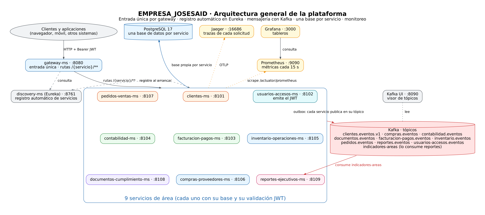

# EMPRESA_JOSESAID

Ecosistema de microservicios del área. Esta carpeta contiene la infraestructura compartida (PostgreSQL 17 y Kafka en modo KRaft) y el `docker-compose.yml` que incluye cada microservicio.

## 1. Mapa de servicios



Diagrama de cada servicio: `<servicio>/docs/diagramas/arquitectura.png`.

| Servicio | Puerto en el host | Notas |
|---|---|---|
| PostgreSQL 17 | 5432 | Una base de datos y un usuario por microservicio |
| Kafka 4.0 | 9092 | Para acceso desde el host. Los contenedores usan `kafka:29092` |
| clientes-ms | 8101 | API de clientes. Ver [clientes-ms/README.md](clientes-ms/README.md) |
| usuarios-accesos-ms | 8102 | Usuarios, roles y emisión de JWT. Ver [usuarios-accesos-ms/README.md](usuarios-accesos-ms/README.md) |
| facturacion-pagos-ms | 8103 | Comprobantes, pagos y cancelaciones. Ver [facturacion-pagos-ms/README.md](facturacion-pagos-ms/README.md) |
| contabilidad-ms | 8104 | Libro contable, pólizas, cierres y balanza. Ver [contabilidad-ms/README.md](contabilidad-ms/README.md) |
| inventario-operaciones-ms | 8105 | Existencias, reservas, lotes y órdenes de operación. Ver [inventario-operaciones-ms/README.md](inventario-operaciones-ms/README.md) |
| compras-proveedores-ms | 8106 | Proveedores con datos cifrados, órdenes de compra y recepciones. Ver [compras-proveedores-ms/README.md](compras-proveedores-ms/README.md) |
| pedidos-ventas-ms | 8107 | Cotizaciones, pedidos, devoluciones y métricas de ventas. Ver [pedidos-ventas-ms/README.md](pedidos-ventas-ms/README.md) |
| documentos-cumplimiento-ms | 8108 | Documentos legales con versiones, cifrado, vencimientos y retención. Ver [documentos-cumplimiento-ms/README.md](documentos-cumplimiento-ms/README.md) |
| reportes-ejecutivos-ms | 8109 | Consolidado de indicadores por periodo, cierre de reportes y exportación. Ver [reportes-ejecutivos-ms/README.md](reportes-ejecutivos-ms/README.md) |
| discovery-ms | 8761 | Registro de servicios (Eureka). Panel en http://localhost:8761. Ver [discovery-ms/README.md](discovery-ms/README.md) |
| gateway-ms | 8080 | Punto de entrada único; enruta a cada servicio registrado. Ver [gateway-ms/README.md](gateway-ms/README.md) |
| prometheus | 9090 | Recolección de métricas de todos los servicios. Ver [sección 11](#11-gateway-descubrimiento-y-monitoreo) |
| kafka-ui | 8090 | Navegador de topics y mensajes de Kafka. Ver [sección 13](#13-kafka-ui-topics-y-mensajes) |
| jaeger | 16686 | Trazas de cada request entre servicios. Ver [sección 12](#12-trazabilidad-con-jaeger) |
| grafana | 3000 | Tableros de métricas (usuario `admin`). Ver [sección 11](#11-gateway-descubrimiento-y-monitoreo) |

## 2. Requisitos

- Docker 24 o posterior y Docker Compose 2.20 o posterior.
- Puertos 5432, 8101 y 9092 libres en el host.

## 3. Primera vez

```bash
docker network create empresa-net          # red externa compartida; solo una vez
cp .env.example .env                       # y complete POSTGRES_PASSWORD y CLIENTES_DB_PASSWORD
cp clientes-ms/.env.example clientes-ms/.env   # y complete las claves de cifrado y JWT_ISSUER_URI
docker compose up -d --build
```

Para generar contraseñas y claves:

```bash
openssl rand -base64 24    # contraseñas de PostgreSQL
openssl rand -base64 32    # CRYPTO_CLAVE_CIFRADO y CRYPTO_CLAVE_INDICE, una por cada una
```

## 4. Variables de `.env` de la raíz

| Variable | Obligatoria | Descripción |
|---|---|---|
| `POSTGRES_PASSWORD` | Sí | Contraseña del superusuario `postgres` |
| `CLIENTES_DB_PASSWORD` | Sí | Contraseña del usuario `clientes`. Debe ser igual a la de `clientes-ms/.env` |
| `USUARIOS_ACCESOS_DB_PASSWORD` | Sí | Contraseña del usuario `usuarios_accesos` |
| `USUARIOS_JWT_SECRET` | Sí | Secreto JWT (mínimo 32 caracteres). Lo usan usuarios-accesos-ms y facturacion-pagos-ms |
| `FACTURACION_DB_PASSWORD` | Sí | Contraseña del usuario `facturacion_pagos` |
| `CONTABILIDAD_DB_PASSWORD` | Sí | Contraseña del usuario `contabilidad` |
| `INVENTARIO_DB_PASSWORD` | Sí | Contraseña del usuario `inventario` |
| `COMPRAS_DB_PASSWORD` | Sí | Contraseña del usuario `compras` |
| `COMPRAS_CIFRADO_CLAVE` | Sí | Clave AES-256 en base64 para datos fiscales de proveedores. Respáldala. |
| `COMPRAS_INDICE_CLAVE` | Sí | Clave HMAC en base64 para buscar proveedores por RFC. Respáldala. |
| `PEDIDOS_DB_PASSWORD` | Sí | Contraseña del usuario `pedidos` |
| `DOCUMENTOS_DB_PASSWORD` | Sí | Contraseña del usuario `documentos` |
| `DOCUMENTOS_CIFRADO_CLAVE` | Sí | Clave AES-256 en base64 para archivos legales. Respáldela. |
| `REPORTES_DB_PASSWORD` | Sí | Contraseña del usuario `reportes` |
| `GRAFANA_ADMIN_PASSWORD` | Sí | Contraseña del usuario `admin` de Grafana |

Si cambia alguna contraseña después de la primera inicialización, ver la sección 9.

## 5. Comandos habituales

```bash
docker compose up -d                       # levantar todo
docker compose up -d --build clientes-ms   # reconstruir y levantar solo clientes-ms
docker compose ps                          # estado de los servicios
docker compose logs -f clientes-ms         # logs de clientes-ms
docker compose stop                        # detener sin borrar datos
docker compose down                        # detener y quitar contenedores; los volúmenes se conservan
docker compose down -v                     # BORRA los datos de PostgreSQL. Úselo solo en desarrollo
```

Para levantar solo la infraestructura sin microservicios:

```bash
docker compose up -d postgres kafka
```

## 6. Infraestructura compartida

**PostgreSQL 17 (`postgres`)**
- Imagen `postgres:17-alpine`.
- Datos en el volumen `postgres-data`, que sobrevive a `docker compose down`.
- Healthcheck con `pg_isready`.
- El script `infra/postgres/init-databases.sh` se monta en `/docker-entrypoint-initdb.d/`.

**Kafka (`kafka`)**
- Imagen `apache/kafka:4.0.0` en modo KRaft (sin ZooKeeper), con un solo nodo que es broker y controlador.
- Dos listeners: `INTERNAL` (`kafka:29092`) para los contenedores y `EXTERNAL` (`localhost:9092`) para el host.
- Creación automática de tópicos habilitada por defecto, con 3 particiones.

## 7. Script `init-databases.sh`

Crea, para cada microservicio, un usuario con login y una base de datos propiedad de ese usuario.

- Es idempotente: si el rol o la base ya existen, no hace nada.
- Usa `CLIENTES_DB_PASSWORD` del entorno y lo pasa a SQL con `format(%L)`, por lo que caracteres como comillas no rompen el script.
- **Solo se ejecuta cuando el volumen `postgres-data` está vacío**, es decir, en la primera inicialización. Cambiar la variable después no cambia la contraseña del usuario existente (ver sección 9).

Estado actual:

```bash
crear_servicio clientes clientes "${CLIENTES_DB_PASSWORD:?Falta CLIENTES_DB_PASSWORD}"
```

## 8. Agregar un microservicio nuevo

El skill `crea-area-empresa` hace estos pasos automáticamente. Si se hacen a mano:

1. Crear la carpeta `<nombre>-ms/` con su `docker-compose.yml`, `Dockerfile` y `.env.example`.
2. Agregar la entrada en `include:` de esta raíz:
   ```yaml
   include:
     - clientes-ms/docker-compose.yml
     - <nombre>-ms/docker-compose.yml
   ```
3. Agregar una línea en `infra/postgres/init-databases.sh`:
   ```bash
   crear_servicio <nombre> <nombre> "${<NOMBRE>_DB_PASSWORD:?Falta <NOMBRE>_DB_PASSWORD}"
   ```
4. Agregar `<NOMBRE>_DB_PASSWORD=` a `.env.example` y a `.env`.
5. Asignar un puerto de host que no esté en uso.

Como el script solo corre en la primera inicialización, en un entorno ya creado hay que crear el rol y la base a mano o recrear el volumen (ver sección 9).

## 9. Solución de problemas

| Síntoma | Causa | Solución |
|---|---|---|
| `network empresa-net declared as external, but could not be found` | La red no existe | `docker network create empresa-net` |
| `Bind for 0.0.0.0:5432 failed: port is already allocated` | Otro PostgreSQL usa el puerto | Detenga el otro servicio o cambie el puerto del host en el compose |
| `password authentication failed for user "clientes"` | `CLIENTES_DB_PASSWORD` cambió después de la primera inicialización | Cambie la contraseña dentro de PostgreSQL: `ALTER ROLE clientes PASSWORD '...';` o recree el volumen con `docker compose down -v` (borra datos) |
| Un microservicio nuevo no tiene base de datos | El script no corrió porque el volumen ya existía | Cree el rol y la base a mano dentro del contenedor `postgres`, o use `down -v` en desarrollo |
| `Falta CLIENTES_DB_PASSWORD` al levantar | La variable no está en `.env` | Complete `.env` y vuelva a levantar |
| `clientes-ms` reinicia en bucle | Falta una clave de cifrado o `JWT_ISSUER_URI` no es válido | Revise `docker compose logs clientes-ms`; el mensaje indica la variable |
| Kafka no acepta conexiones desde el host | Se usó `kafka:29092` desde el host | Desde el host use `localhost:9092`; desde contenedores use `kafka:29092` |

## 10. Orden de arranque

**Primero:** `discovery-ms`. Los servicios de área se registran al arrancar; si `discovery-ms` se levanta después, aparecen solos en menos de un minuto. Después: `gateway-ms`. El monitoreo puede levantarse en cualquier momento.

Algunos servicios dependen de otros. Este es el orden obligatorio:

1. Red: `docker network create empresa-net` (una sola vez)
2. Raíz: `docker compose up -d postgres kafka`
3. **usuarios-accesos-ms**: emite los tokens que validan los demás
4. **clientes-ms**, **facturacion-pagos-ms**, **contabilidad-ms** **inventario-operaciones-ms**, **compras-proveedores-ms**, **pedidos-ventas-ms** y **documentos-cumplimiento-ms**: pueden levantarse en cualquier orden entre sí. **reportes-ejecutivos-ms** va al final: consume eventos de las áreas y conviene levantarlo cuando las áreas ya publican

Cada microservicio puede arrancar por separado, pero necesita PostgreSQL, Kafka y, si valida tokens, usuarios-accesos-ms. Este mismo orden está en el README de cada servicio.

Si la base de datos ya existía antes de agregar un servicio, `init-databases.sh` no se vuelve a ejecutar. Hay que crear su usuario y su base a mano:

```bash
docker compose exec -T postgres psql -U postgres -c "CREATE ROLE facturacion_pagos LOGIN PASSWORD 'VALOR_DE_FACTURACION_DB_PASSWORD';" -c "CREATE DATABASE facturacion_pagos OWNER facturacion_pagos;"
```

Para contabilidad-ms, la misma regla aplica con su usuario: `CREATE ROLE contabilidad LOGIN PASSWORD '...'; CREATE DATABASE contabilidad OWNER contabilidad;`.

## 11. Gateway, descubrimiento y monitoreo

**Descubrimiento (`discovery-ms`, 8761).** Servidor Eureka. Cada servicio se registra al arrancar usando el nombre de su contenedor en `empresa-net`. Panel: http://localhost:8761.

**Gateway (`gateway-ms`, 8080).** Punto de entrada único. Cada servicio registrado queda disponible en `http://localhost:8080/{nombre-del-servicio}/...` sin configurar rutas a mano. Ejemplo: `http://localhost:8080/usuarios-accesos-ms/v1/auth/login`. El gateway no valida tokens: pasa el encabezado `Authorization` y cada servicio valida su JWT.

**Monitoreo (`infra/monitoring`).** Prometheus (9090) lee `/actuator/prometheus` de cada servicio cada 15 segundos. Grafana (3000) ya tiene Prometheus como fuente de datos; para ver tableros, importe el dashboard "JVM (Micrometer)" (ID 4701) desde Dashboards → Import.

**Límites conocidos:**
- Las métricas no requieren token; solo son accesibles dentro de la red y por los puertos publicados en tu Mac.
- Los objetivos de Prometheus están fijos en `infra/monitoring/prometheus.yml`. Un servicio nuevo debe agregarse ahí.
- El panel de Eureka no tiene autenticación. Úselo solo en la red local.

## 12. Trazabilidad con Jaeger

Cada request que entra por el gateway genera una traza con sus pasos en cada servicio. Interfaz: http://localhost:16686. Elija el servicio en **Service** (por ejemplo `gateway-ms` o `clientes-ms`) y pulse **Find Traces**.

- Las trazas se envían por OTLP a `http://jaeger:4318`. Para correr un servicio fuera de Docker, defina `TRAZAS_OTLP_ENDPOINT=http://localhost:4318/v1/traces`.
- Muestreo al 100%. En producción conviene bajarlo para no saturar el almacenamiento.
- Las trazas viven en memoria de Jaeger: al reiniciar el contenedor se pierden.

## 13. Kafka UI: topics y mensajes

Interfaz web de Kafka en http://localhost:8090 (clúster `empresa`).

- **Topics:** lista de tópicos, particiones y mensajes. Pestaña **Messages** para leer el contenido de cada mensaje.
- **Consumer Groups:** muestra qué grupos (por ejemplo `reportes-ejecutivos-ms`) leen cada tópico y si van atrasados.
- Solo lectura en la práctica: úsela para revisar, no para publicar mensajes de producción.
- Tópicos de referencia: `indicadores-areas` (entrada de reportes) y los eventos de los outbox de cada servicio.
