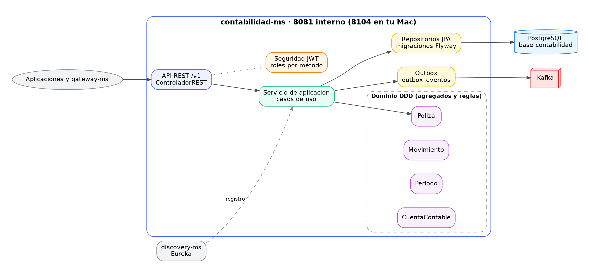
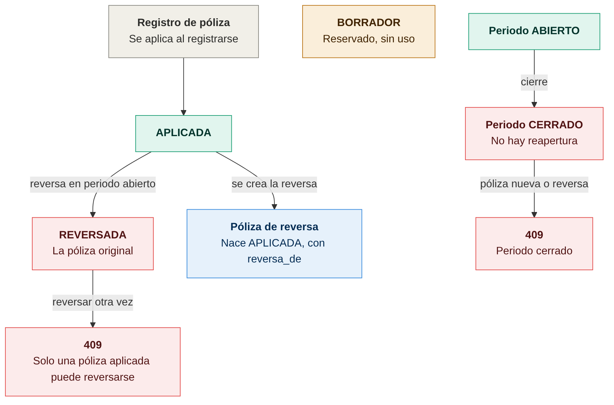
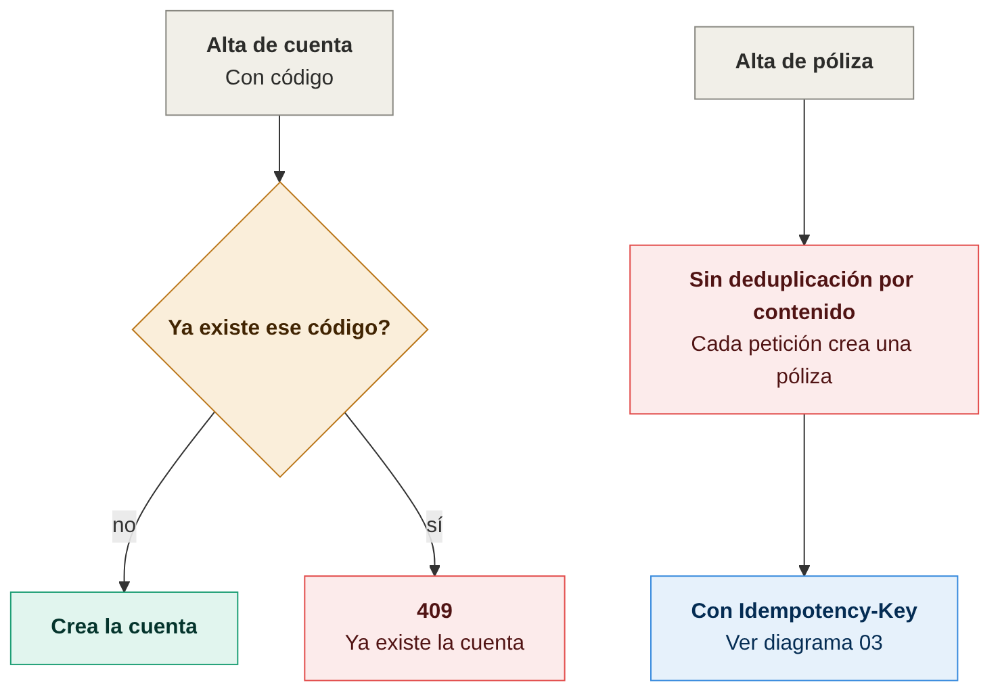
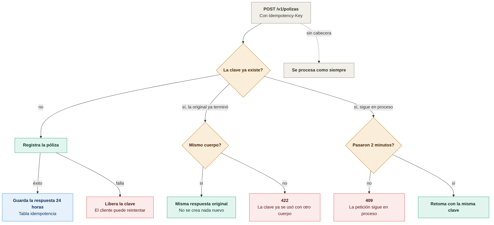

# Diagramas de contabilidad-ms

Todos los diagramas son imágenes PNG. Cada imagen tiene su fuente en Mermaid (`.mmd`) en `docs/diagramas/`; para regenerarla:

```bash
cd docs/diagramas
mmdc -i nombre.mmd -o nombre.png -b white -w 1400 -s 2
```

## Arquitectura



## Estados, duplicados e idempotencia

### Máquina de estados de la póliza


Una póliza se aplica al registrarse y solo una `APLICADA` puede reversarse; la reversa nace `APLICADA` y apunta a la original. Un periodo cerrado no admite pólizas nuevas ni reversas, y no se reabre. `BORRADOR` está reservado. Fuente: [01-maquina-de-estados-poliza.mmd](diagramas/01-maquina-de-estados-poliza.mmd).

### Reglas de duplicados


El código de cuenta es único: un duplicado responde 409. Las pólizas no se deduplican por contenido; el control contra reintentos es la `Idempotency-Key`. Fuente: [02-reglas-de-duplicados.mmd](diagramas/02-reglas-de-duplicados.mmd).

### Idempotency-Key en pólizas


Con la misma clave y el mismo cuerpo se devuelve la respuesta original. Con otro cuerpo responde 422, y si la petición original sigue en proceso responde 409 hasta que pasen 2 minutos. Fuente: [03-idempotency-key-en-polizas.mmd](diagramas/03-idempotency-key-en-polizas.mmd).
