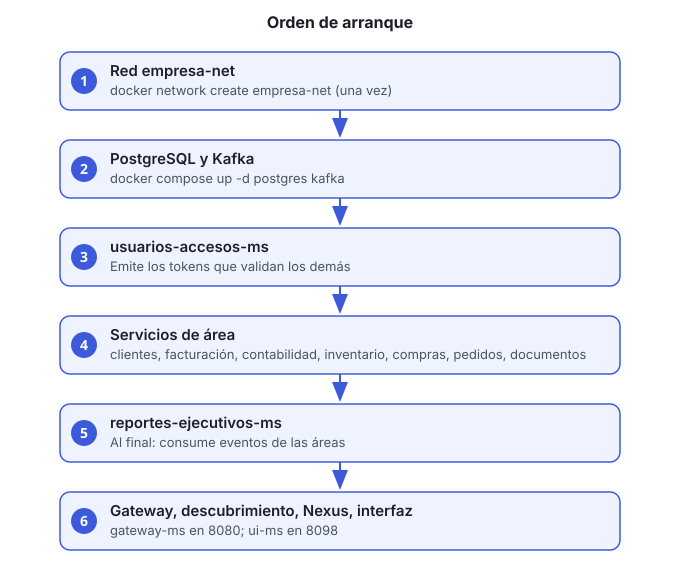

# Guía 1. Levantar el ecosistema completo

**Objetivo:** dejar arriba todos los servicios en el orden correcto y confirmar que responden.

**Tiempo estimado:** 15 a 25 minutos la primera vez (descarga de imágenes y compilación). Después, 3 a 5 minutos.



## Antes de empezar

- Docker Desktop (o Docker Engine) abierto y con al menos 8 GB de memoria asignada.
- Repositorio clonado en tu máquina.
- Contraseñas y claves generadas con los comandos de la sección 3 del [README de la raíz](../../README.md#3-primera-vez).

## Pasos

1. **Crea la red compartida.** Es una sola vez por máquina:

   ```bash
   docker network create empresa-net
   ```

   Si el comando responde que la red ya existe, sigue con el paso 2.

2. **Prepara las variables de entorno.** Copia las plantillas y completa los valores vacíos:

   ```bash
   cp .env.example .env
   cp clientes-ms/.env.example clientes-ms/.env
   ```

   En `.env` completa al menos `POSTGRES_PASSWORD`, `CLIENTES_DB_PASSWORD`, `USUARIOS_JWT_CLAVE_PRIVADA`, `USUARIOS_ADMIN_INICIAL_CORREO` y `USUARIOS_ADMIN_INICIAL_PASSWORD`. La lista completa está en la [sección 4 del README](../../README.md#4-variables-de-env-de-la-raíz). Nunca subas el `.env` al repositorio.

3. **Levanta la infraestructura: PostgreSQL y Kafka.**

   ```bash
   docker compose up -d postgres kafka
   ```

   Espera a que ambos estén `healthy`:

   ```bash
   docker compose ps postgres kafka
   ```

4. **Levanta usuarios-accesos-ms.** Los demás servicios validan tokens con él, así que va primero:

   ```bash
   docker compose up -d --build usuarios-accesos-ms
   ```

5. **Levanta los servicios de área.** Pueden arrancar en cualquier orden entre ellos:

   ```bash
   docker compose up -d --build clientes-ms facturacion-pagos-ms contabilidad-ms inventario-operaciones-ms compras-proveedores-ms pedidos-ventas-ms documentos-cumplimiento-ms
   ```

6. **Levanta reportes-ejecutivos-ms.** Va al final porque consume eventos de las áreas:

   ```bash
   docker compose up -d --build reportes-ejecutivos-ms
   ```

7. **Levanta el gateway, el descubrimiento, Nexus y la interfaz.** La interfaz (`ui-ms`) tiene su propio archivo de Compose:

   ```bash
   docker compose up -d --build discovery-ms gateway-ms nexus-ms
   docker compose -f ui-ms/docker-compose.yml up -d --build
   ```

   > `ui-ms` no está en el Compose de la raíz. Si intentas `docker compose up ui-ms` desde la raíz, Compose responde «no such service».

8. **Revisa el estado de todos los contenedores:**

   ```bash
   docker compose ps
   ```

   Todos deben aparecer como `running`. Si alguno está en `restarting` o `exited`, revisa sus logs:

   ```bash
   docker compose logs --tail=100 NOMBRE_DEL_SERVICIO
   ```

## Verificación

- Entra a `http://localhost:8080` (gateway). Debe responder aunque sea con un error de autenticación; eso confirma que el gateway está arriba.
- Inicia sesión con el administrador inicial:

  ```bash
  curl -s -X POST http://localhost:8080/usuarios-accesos-ms/v1/auth/login \
    -H "Content-Type: application/json" \
    -d '{"correo":"TU_CORREO_ADMIN","password":"TU_CONTRASEÑA_ADMIN"}'
  ```

  La respuesta debe traer `accessToken`. Si responde `cambio-password-requerido`, cambia la contraseña inicial con `POST /v1/auth/cambiar-password-inicial` (ver la guía 5).

- Abre la interfaz en `http://localhost:8098`.

## Problemas comunes

| Síntoma | Causa probable | Qué hacer |
|---|---|---|
| `network empresa-net not found` | Falta el paso 1 | Ejecuta `docker network create empresa-net` |
| Un servicio se reinicia en bucle | Variable de entorno faltante | Revisa `docker compose logs NOMBRE` y completa el `.env` |
| 404 en una ruta que sí existe | Hay dos contenedores del mismo servicio | Revisa con `docker ps` y elimina el duplicado |
| El gateway responde 401 en todo | `usuarios-accesos-ms` no está arriba | Levántalo (paso 4) y vuelve a probar |
| La interfaz muestra la versión anterior | La imagen no se reconstruyó | Repite el paso 7 con `--build` |

Para más casos, consulta la [sección 9 del README](../../README.md#9-solución-de-problemas).
