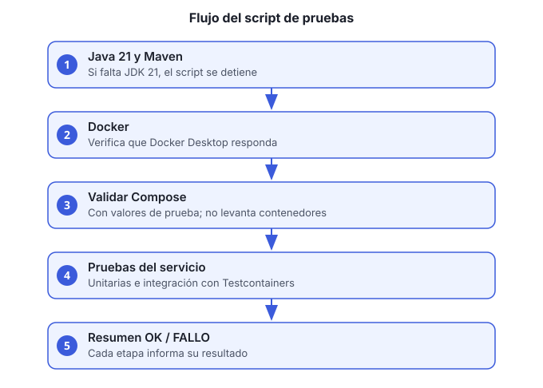

# Guía 2. Ejecutar las pruebas de un servicio

**Objetivo:** correr las pruebas unitarias y de integración de un servicio con un solo comando, y obtener un resumen de OK o FALLO.



## Antes de empezar

- macOS con **Docker Desktop abierto**. Los scripts `ejecutar-pruebas-<servicio>.sh` están pensados para Mac.
- **JDK 21.** Si no lo tienes:

  ```bash
  brew install --cask temurin@21
  brew install maven
  ```

- Repositorio clonado. Los scripts se ejecutan desde la raíz.

## Scripts disponibles

| Script | Servicio |
|---|---|
| `ejecutar-pruebas-usuarios.sh` | usuarios-accesos-ms |
| `ejecutar-pruebas-clientes.sh` | clientes-ms |
| `ejecutar-pruebas-facturacion.sh` | facturacion-pagos-ms |
| `ejecutar-pruebas-contabilidad.sh` | contabilidad-ms |
| `ejecutar-pruebas-inventario.sh` | inventario-operaciones-ms |
| `ejecutar-pruebas-compras.sh` | compras-proveedores-ms |
| `ejecutar-pruebas-pedidos.sh` | pedidos-ventas-ms |
| `ejecutar-pruebas-documentos.sh` | documentos-cumplimiento-ms |
| `ejecutar-pruebas-reportes.sh` | reportes-ejecutivos-ms |
| `ejecutar-pruebas-nexus.sh` | nexus-ms |
| `ejecutar-pruebas.sh` | Script general del repositorio |

## Pasos

1. **Verifica Docker** (opcional, pero evita esperas):

   ```bash
   bash verificar-docker.sh
   ```

2. **Dale permiso de ejecución a los scripts** (solo la primera vez, o si los copiaste de otra máquina):

   ```bash
   chmod +x ejecutar-pruebas*.sh
   ```

3. **Ejecuta el script del servicio:**

   ```bash
   bash ejecutar-pruebas-usuarios.sh
   ```

4. **Espera el resumen.** El script corre estas etapas en orden. Cada una imprime `OK:` o `FALLO:`:
   1. Revisa Java 21 y Maven. Si no encuentra JDK 21, se detiene con un mensaje.
   2. Revisa que Docker responda.
   3. Valida los archivos de Compose con valores de prueba. No levanta contenedores.
   4. Corre las pruebas completas del servicio: unitarias e integración con Testcontainers, que levanta sus propias bases temporales y no toca tus bases de desarrollo.

5. **Revisa los detalles** de un fallo en la salida de Maven: el script no los repite. Los reportes de cobertura quedan en `NOMBRE-ms/target/site/jacoco/index.html` cuando el build los genera.

## Verificación

El resumen final indica cuántas etapas pasaron y cuántas fallaron. Una corrida correcta termina sin fallos. La cobertura y el estilo (JaCoCo, Checkstyle, PMD, SpotBugs) están en modo reporte: no cortan el build, así que revisa sus reportes si quieres detalles (ver la sección 2 de `pendientes/pendientes-documentacion.md`).

## Problemas comunes

| Síntoma | Qué hacer |
|---|---|
| `No encuentro JDK 21` | Instala Temurin 21 y vuelve a ejecutar |
| `Docker responde` en FALLO | Abre Docker Desktop y espera a que el icono indique que está listo |
| Testcontainers no conecta | Revisa que Docker tenga memoria suficiente (8 GB recomendado) |
| Falla solo la etapa de Compose | Revisa que el servicio tenga su `docker-compose.yml` y que las variables de prueba coincidan con las requeridas |

Si necesitas ayuda con la salida, pega el resumen completo, no solo la línea de error.
