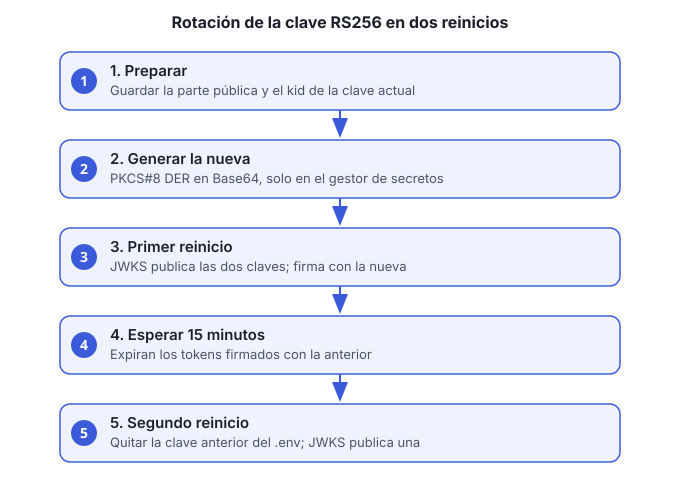

# Guía 3. Rotar la clave RS256 sin cortar sesiones

**Objetivo:** cambiar la clave con la que `usuarios-accesos-ms` firma los tokens, sin que los usuarios pierdan la sesión.

**Cuándo:** al menos una vez al año, o de inmediato si la clave privada se expone.



Esta guía es el procedimiento completo. La referencia técnica está en la [sección «Rotación de la clave RS256»](../../usuarios-accesos-ms/README.md#rotación-de-la-clave-rs256) del README del servicio.

## Idea general

Los servicios validan el token por su `kid` (identificador de la clave). Durante la rotación se publican **dos** claves en `/.well-known/jwks.json`: la nueva firma y la anterior sigue validando. Cuando expiran los tokens firmados con la anterior (15 minutos por defecto), se quita. Son dos reinicios de `usuarios-accesos-ms`, y ningún otro servicio se reinicia.

Los refresh tokens son opacos y no cambian con la rotación.

## Antes de empezar

- Acceso al gestor de secretos donde está `USUARIOS_JWT_CLAVE_PRIVADA`.
- `openssl` instalado.
- Una ventana de cambio de al menos 20 minutos (dos reinicios y una espera).

## Pasos

1. **Obtén la parte pública de la clave actual** y su `kid`. Guárdalos; los usarás en el paso 3:

   ```bash
   echo "$USUARIOS_JWT_CLAVE_PRIVADA" | base64 -d | openssl pkey -inform DER -pubout -outform DER | base64
   ```

   El `kid` actual es el valor de `USUARIOS_JWT_KID` (por defecto `empresa-usuarios-1`).

2. **Genera la clave nueva** en PKCS#8 DER en Base64 y guárdala **solo** en el gestor de secretos:

   ```bash
   openssl genrsa 2048 | openssl pkcs8 -topk8 -nocrypt -outform DER | base64
   ```

   No la pegues en el chat, en un commit ni en un archivo del repositorio.

3. **Actualiza el `.env` de la raíz:**

   | Variable | Valor |
   |---|---|
   | `USUARIOS_JWT_CLAVE_PRIVADA` | La clave nueva (paso 2) |
   | `USUARIOS_JWT_KID` | Un valor nuevo, por ejemplo `empresa-usuarios-2` |
   | `USUARIOS_JWT_CLAVE_PUBLICA_ANTERIOR` | La parte pública de la clave anterior (paso 1) |
   | `USUARIOS_JWT_KID_ANTERIOR` | El `kid` anterior |

4. **Primer reinicio.** Desde aquí el JWKS publica las dos claves y los tokens nuevos se firman con la clave nueva:

   ```bash
   docker compose up -d usuarios-accesos-ms
   ```

5. **Espera al menos 15 minutos.** Ese es el tiempo de vida de un access token. Durante la espera, los tokens de ambas claves siguen siendo válidos.

6. **Quita la clave anterior** del `.env`: borra `USUARIOS_JWT_CLAVE_PUBLICA_ANTERIOR` y `USUARIOS_JWT_KID_ANTERIOR`.

7. **Segundo reinicio.** El JWKS deja de publicar la clave anterior:

   ```bash
   docker compose up -d usuarios-accesos-ms
   ```

## Verificación

Consulta el JWKS desde un contenedor de la red (el gateway no enruta `/.well-known/`). Debe listar **una** sola clave, con el `kid` nuevo:

```bash
docker compose exec usuarios-accesos-ms curl -s http://localhost:8081/.well-known/jwks.json
```

> Si la imagen del servicio no trae `curl`, consulta la misma URL desde otro contenedor de la red `empresa-net`: `http://usuarios-accesos-ms:8081/.well-known/jwks.json`.

Luego inicia sesión y revisa que el `accessToken` tenga el `kid` nuevo en el encabezado (la primera parte del token, decodificada en Base64, muestra `"kid"`).

## Si la clave se expone

No esperes los 15 minutos:

1. Genera una clave nueva (paso 2).
2. Actualiza `USUARIOS_JWT_CLAVE_PRIVADA` y `USUARIOS_JWT_KID`, y **no** pongas la anterior en `_ANTERIOR`.
3. Reinicia una vez. Los tokens firmados con la clave expuesta dejan de validarse.
4. Cierra las sesiones de los usuarios afectados con `POST /v1/auth/logout-todas`, o pide que vuelvan a iniciar sesión.

## Problemas comunes

| Síntoma | Causa probable | Qué hacer |
|---|---|---|
| Tokens de 401 justo después del paso 4 | El reinicio no tomó el `.env` nuevo | Verifica con `docker compose config` y reinicia otra vez |
| El JWKS sigue mostrando dos claves después del paso 7 | No se quitó la variable anterior del `.env` | Revisa el `.env` y reinicia |
| Un servicio no valida un token nuevo | Usa un JWKS en caché | Los servicios recargan el JWKS al recibir un `kid` desconocido; si persiste, reinícialo |
