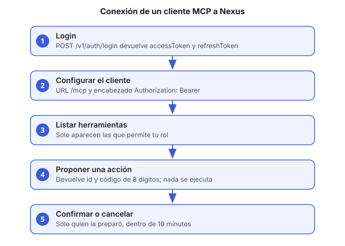

# Guía 4. Conectar un cliente MCP a Nexus

**Objetivo:** usar las herramientas de Nexus desde un cliente MCP (por ejemplo, un asistente de escritorio que acepte servidores MCP remotos) con tu propio usuario y tu rol.



Un cliente MCP no tiene permisos propios: cada llamada usa tu **access token**, así que solo ves y puedes hacer lo que permite tu rol.

## Antes de empezar

- Un usuario activo con correo y contraseña definitiva.
- La URL del gateway de tu ambiente (aquí `http://HOST`; en local, `http://localhost:8080`).

## Pasos

1. **Inicia sesión y guarda los dos tokens:**

   ```bash
   curl -s -X POST http://HOST/usuarios-accesos-ms/v1/auth/login \
     -H "Content-Type: application/json" \
     -d '{"correo":"TU_CORREO","password":"TU_CONTRASEÑA"}'
   ```

   La respuesta trae `accessToken` (vence en 15 minutos) y `refreshToken` (vence 7 días después de su último uso).

2. **Configura el cliente MCP:**
   - **URL del servidor:** `http://HOST/mcp`
   - **Encabezado:** `Authorization: Bearer ACCESS_TOKEN`

   El campo exacto cambia de un cliente a otro. Revisa la documentación del cliente para «servidor MCP remoto» y «encabezados».

3. **Prueba la conexión.** Pide al cliente que liste las herramientas. Debes ver al menos `consultar_politicas`, `sugerir_poliza`, `confirmar_accion` y `cancelar_accion`, además de las que correspondan a tu rol.

4. **Renueva el token cuando venza.** Cada 15 minutos, o cuando el cliente responda 401:

   ```bash
   curl -s -X POST http://HOST/usuarios-accesos-ms/v1/auth/refresh \
     -H "Content-Type: application/json" \
     -d '{"refreshToken":"REFRESH_TOKEN"}'
   ```

   La respuesta trae un refresh token **nuevo**. Guarda siempre el último: el anterior queda invalidado.

   > Si usas un refresh token que ya fue rotado, el servicio revoca toda la sesión por seguridad. Vuelve al paso 1.

5. **Cierra la sesión al terminar** en un equipo compartido:

   ```bash
   curl -s -X POST http://HOST/usuarios-accesos-ms/v1/auth/logout \
     -H "Content-Type: application/json" \
     -d '{"refreshToken":"REFRESH_TOKEN"}'
   ```

## Cómo funciona una acción que modifica datos

Las herramientas que escriben no ejecutan nada de inmediato:

1. `sugerir_poliza` (o la herramienta de la acción) **prepara** la acción y devuelve un **id** y un **código de confirmación de 8 dígitos**.
2. Revisas la propuesta en el cliente.
3. `confirmar_accion` con el id y el código la ejecuta. Solo funciona para quien la preparó y dentro de **10 minutos**.
4. `cancelar_accion` la descarta sin ejecutarla.

Si el código es incorrecto, la acción se cancela por seguridad: hay que pedir una nueva propuesta.

## Verificación

- El cliente lista las herramientas del paso 3.
- Una consulta de lectura (por ejemplo, `consultar_politicas`) devuelve resultados.
- Una propuesta muestra id y código, y no cambia datos hasta que la confirmas.

## Problemas comunes

| Síntoma | Causa | Qué hacer |
|---|---|---|
| 401 en todas las llamadas | El token venció o está mal copiado | Renueva el token (paso 4) |
| 403 en una herramienta | Tu rol no tiene permiso | Pide el rol al administrador |
| `confirmar_accion` falla | Pasaron 10 minutos o confirma otro usuario | Pide una nueva propuesta |
| El cliente no ve herramientas | URL sin `/mcp` o sin `http://` | Corrige la URL del paso 2 |

Notas del piloto y decisiones de diseño: [conexion-mcp.md](../../nexus-ms/docs/conexion-mcp.md).
