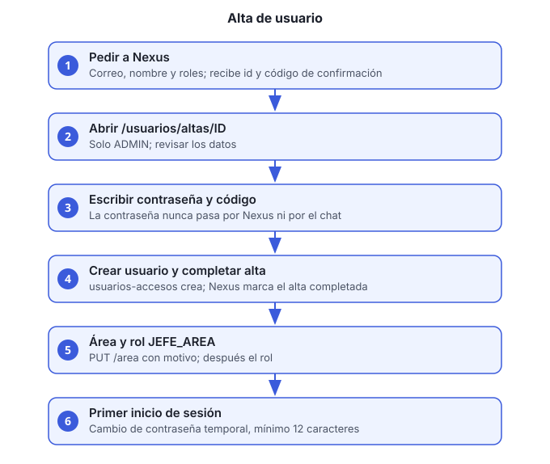

# Guía 5. Dar de alta un usuario y asignarle rol y área

**Objetivo:** crear un usuario nuevo con su rol, su contraseña temporal y, si aplica, su área.

**Quién puede hacerlo:** solo un usuario con rol `ADMIN`.



## Principio de seguridad

**La contraseña nunca pasa por el asistente.** Nexus prepara el alta y genera un código de confirmación. La contraseña temporal la escribes tú en la interfaz (`ui-ms`), en un campo de tipo contraseña. Nexus, el chat y el historial no la reciben.

## Antes de empezar

- Usuario con rol `ADMIN`.
- Correo del nuevo usuario y su nombre completo.
- Una contraseña temporal que definas tú. Se la das al usuario por un canal seguro; él la cambia en su primer inicio de sesión.
- Los roles que vas a asignar. Los permitidos en un alta son: `ADMIN`, `FINANZAS`, `CONTADOR`, `VENTAS`, `COMPRAS`, `ALMACEN`, `OPERACIONES`, `CALIDAD`, `DIRECCION` y `LEGAL`. **`JEFE_AREA` no se asigna en el alta**: ver el paso 6.

## Pasos

1. **Pide la preparación a Nexus** en el chat o desde tu cliente MCP. Indica el correo, el nombre completo y los roles:

   > Da de alta a ana@empresa.com, Ana López, con el rol VENTAS.

   Nexus valida el correo y los roles, y responde con el **id del alta**, un **código de confirmación de 8 dígitos** y el enlace `/usuarios/altas/ID`. Ese código es de un solo uso y tiene vigencia.

2. **Abre el enlace** en la interfaz: `http://HOST:8098/usuarios/altas/ID`. Solo un administrador puede abrirlo.

3. **Revisa los datos del alta.** La página muestra correo, nombre y roles. Si algo no es correcto, no la completes: vuelve al paso 1 con los datos corregidos.

4. **Escribe la contraseña temporal y el código** de confirmación, y envía el formulario.

   La interfaz sigue este orden:
   1. Pide a Nexus los datos del alta.
   2. Verifica el código con Nexus.
   3. Crea el usuario en `usuarios-accesos-ms`.
   4. Marca el alta como completada en Nexus.

   > Si la creación falla, el alta sigue pendiente y puedes reintentar. Si falla **después** de crear el usuario, la página te lo indica: no repitas la creación; revisa la lista de usuarios.

5. **Confirma que el usuario existe.** Pide la lista a Nexus (`listar_usuarios`) o consulta el servicio. Anota el **id** del usuario; lo necesitas para el área.

6. **Asigna el área, si aplica.** Solo con token de `ADMIN`. El motivo es obligatorio:

   ```bash
   curl -s -X PUT http://HOST/usuarios-accesos-ms/v1/usuarios/USUARIO_ID/area \
     -H "Authorization: Bearer ACCESS_TOKEN" \
     -H "Content-Type: application/json" \
     -d '{"area":"VENTAS_ATENCION_CLIENTES","motivo":"Alta de nuevo ingreso"}'
   ```

   Las áreas válidas son las del enum de reportes: `VENTAS_ATENCION_CLIENTES`, `FINANZAS_CONTABILIDAD`, `OPERACIONES`, `COMPRAS_PROVEEDORES`, `ADMINISTRACION_LEGAL` y `DIRECCION_GENERAL`. Un valor desconocido responde 422.

7. **Asigna `JEFE_AREA`, si aplica.** Este rol exige área. El orden es obligatorio: primero el área (paso 6), después el rol. Si intentas asignar el rol sin área, responde 422.

8. **Entrega la contraseña temporal** al usuario por un canal seguro.

9. **El usuario cambia la contraseña en su primer inicio de sesión.** Mientras la contraseña sea temporal, el login responde 403 `cambio-password-requerido`. Para cambiarla:

   ```bash
   curl -s -X POST http://HOST/usuarios-accesos-ms/v1/auth/cambiar-password-inicial \
     -H "Content-Type: application/json" \
     -d '{"correo":"ana@empresa.com","passwordActual":"TEMPORAL","passwordNueva":"NUEVA_DE_12_O_MAS"}'
   ```

   La contraseña nueva debe tener al menos 12 caracteres. La respuesta es 204.

## Verificación

- `listar_usuarios` muestra al usuario con sus roles.
- El usuario puede iniciar sesión después de cambiar la contraseña.
- Si tiene área, el token incluye el claim `area` **después de iniciar sesión de nuevo**. Un usuario con sesión abierta antes del cambio no lo trae hasta volver a entrar.

## Problemas comunes

| Síntoma | Causa | Qué hacer |
|---|---|---|
| `El alta no existe` | Expiró o ya se completó | Prepara un alta nueva |
| El código no coincide | Se escribió mal o es de otra alta | Revisa el código de la respuesta de Nexus. Un código incorrecto cancela el alta: hay que prepararla de nuevo |
| 422 al asignar `JEFE_AREA` | No tiene área | Asigna el área primero (paso 6) |
| 403 `cambio-password-requerido` | Contraseña temporal sin cambiar | Completa el paso 9 |
| Reportes responde 403 al usuario | El área no coincide con el enum de reportes | Corrige el área con el paso 6 |
