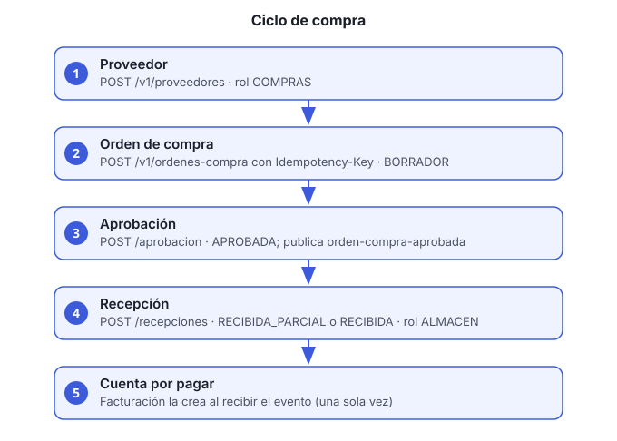

# Guía 6. Crear un proveedor, una orden de compra, aprobarla y registrar la recepción

**Objetivo:** recorrer el ciclo de compra completo: alta del proveedor, orden, aprobación, recepción de mercancía y, al aprobar, la cuenta por pagar que se genera en finanzas.

**Servicio:** `compras-proveedores-ms`, con el gateway como entrada. Todas las rutas van bajo `/compras-proveedores-ms/v1`.



## Roles

| Paso | Rol requerido |
|---|---|
| Alta de proveedor | `COMPRAS` |
| Crear orden | `COMPRAS` |
| Aprobar orden | `COMPRAS` o `DIRECCION` |
| Registrar recepción | `ALMACEN` |
| Cancelar orden | `COMPRAS` |
| Consultar proveedores | `COMPRAS` o `FINANZAS` |
| Consultar órdenes | `COMPRAS`, `ALMACEN` o `DIRECCION` |

Para todo, usa un access token vigente en el encabezado `Authorization: Bearer ACCESS_TOKEN`.

## Antes de empezar

- Usuario con el rol que corresponda a cada paso.
- El artículo debe existir en inventario con su SKU.
- Datos del proveedor: razón social, RFC y correo.

## Pasos

1. **Da de alta al proveedor** (rol `COMPRAS`):

   ```bash
   curl -s -X POST http://HOST/compras-proveedores-ms/v1/proveedores \
     -H "Authorization: Bearer ACCESS_TOKEN" -H "Content-Type: application/json" \
     -d '{"razonSocial":"Papelería del Centro SA de CV","rfc":"PCE010101AAA","correo":"ventas@proveedor.mx"}'
   ```

   Anota el `id` de la respuesta.

2. **Crea la orden de compra** (rol `COMPRAS`). Envía el encabezado `Idempotency-Key` con un valor único por intento. Si la red falla y repites la petición con la **misma** clave, no se duplica la orden:

   ```bash
   curl -s -X POST http://HOST/compras-proveedores-ms/v1/ordenes-compra \
     -H "Authorization: Bearer ACCESS_TOKEN" -H "Content-Type: application/json" \
     -H "Idempotency-Key: $(uuidgen)" \
     -d '{"proveedorId":"PROVEEDOR_ID","moneda":"MXN","lineas":[{"articuloSku":"PAP-A4-500","cantidad":10,"precioUnitario":85.00}]}'
   ```

   La orden nace en estado `BORRADOR`. Anota su `id`.

   Los estados son: `BORRADOR` → `APROBADA` → `RECIBIDA_PARCIAL` → `RECIBIDA`, y `CANCELADA` desde borrador o aprobada.

3. **Consulta la orden** para revisar subtotal y estatus:

   ```bash
   curl -s http://HOST/compras-proveedores-ms/v1/ordenes-compra/ORDEN_ID \
     -H "Authorization: Bearer ACCESS_TOKEN"
   ```

4. **Aprueba la orden** (rol `COMPRAS` o `DIRECCION`):

   ```bash
   curl -s -X POST http://HOST/compras-proveedores-ms/v1/ordenes-compra/ORDEN_ID/aprobacion \
     -H "Authorization: Bearer ACCESS_TOKEN"
   ```

   > Al aprobarse, la orden publica el evento `orden-compra-aprobada`. Facturación y pagos crea entonces la **cuenta por pagar** de la orden. Esa cuenta se crea una sola vez aunque el evento llegue dos veces. Ver la guía 7.

5. **Envía la mercancía y registra la recepción** (rol `ALMACEN`). Indica la cantidad recibida por SKU:

   ```bash
   curl -s -X POST http://HOST/compras-proveedores-ms/v1/ordenes-compra/ORDEN_ID/recepciones \
     -H "Authorization: Bearer ACCESS_TOKEN" -H "Content-Type: application/json" \
     -d '{"lineas":[{"articuloSku":"PAP-A4-500","cantidad":10}]}'
   ```

   Puedes registrar recepciones parciales: la orden pasa a `RECIBIDA_PARCIAL` y la respuesta muestra `cantidadRecibida` por línea frente a `cantidadOrdenada`. Cuando todas las líneas quedan completas, pasa a `RECIBIDA`.

6. **Cancela la orden si ya no procede** (rol `COMPRAS`). Debe llevar motivo:

   ```bash
   curl -s -X POST http://HOST/compras-proveedores-ms/v1/ordenes-compra/ORDEN_ID/cancelacion \
     -H "Authorization: Bearer ACCESS_TOKEN" -H "Content-Type: application/json" \
     -d '{"motivo":"El proveedor no pudo surtir"}'
   ```

## Verificación

- `GET /ordenes-compra/ORDEN_ID` muestra el estatus aprobada y, al final de la recepción, las cantidades recibidas.
- En facturación y pagos (guía 7), la cuenta por pagar existe con el total de la orden.

## Problemas comunes

| Síntoma | Causa | Qué hacer |
|---|---|---|
| 403 al crear la orden | El usuario no tiene rol `COMPRAS` | Pide el rol al administrador (guía 5) |
| Se creó dos veces la misma orden | Se repitió la petición con otra `Idempotency-Key` | Usa la misma clave al reintentar |
| No aparece la cuenta por pagar | El evento aún no llegó | Espera unos segundos y consulta de nuevo; si no aparece, revisa los logs de `facturacion-pagos-ms` y de Kafka |
| Error de SKU | El artículo no existe en inventario | Da de alta el artículo en `inventario-operaciones-ms` |
