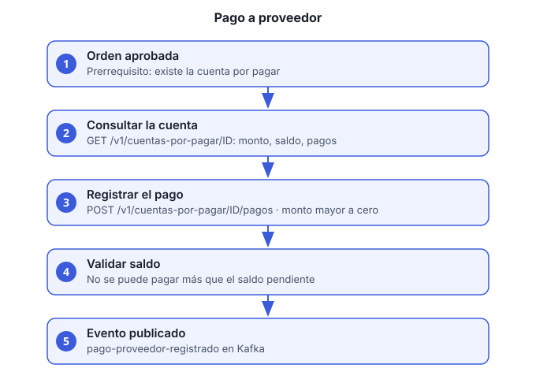

# Guía 7. Registrar un pago a proveedor contra una cuenta por pagar

**Objetivo:** aplicar un pago a la cuenta por pagar que se creó al aprobar una orden de compra.

**Rol requerido:** `FINANZAS`.

**Servicio:** `facturacion-pagos-ms`, bajo `/facturacion-pagos-ms/v1/cuentas-por-pagar`.



## Antes de empezar

- La orden de compra debe estar **aprobada** (guía 6, paso 4). Sin aprobación no hay cuenta por pagar.
- Un token de un usuario con rol `FINANZAS`.

## Pasos

1. **Localiza la cuenta por pagar.** Lista los pagos recientes; cada uno trae el `cuentaId`:

   ```bash
   curl -s "http://HOST/facturacion-pagos-ms/v1/cuentas-por-pagar/pagos" \
     -H "Authorization: Bearer ACCESS_TOKEN"
   ```

   > Hoy el servicio no tiene una consulta de cuentas por `ordenId`. Si la cuenta aún no tiene pagos, no aparece en esta lista, y el id hay que obtenerlo de otra forma (pendiente: ver la sección de pendientes).

2. **Revisa el saldo.** `GET /v1/cuentas-por-pagar/CUENTA_ID` devuelve `monto` (total de la orden), `saldo` (lo que falta por pagar), `estatus` y la lista de `pagos` registrados.

3. **Registra el pago:**

   ```bash
   curl -s -X POST http://HOST/facturacion-pagos-ms/v1/cuentas-por-pagar/CUENTA_ID/pagos \
     -H "Authorization: Bearer ACCESS_TOKEN" -H "Content-Type: application/json" \
     -d '{"monto":850.00,"fechaPago":"2026-11-05","referencia":"SPEI-123456"}'
   ```

   - `monto` es obligatorio y mayor a cero.
   - `fechaPago` es opcional. Si no la envías, se usa la fecha de hoy.
   - `referencia` es opcional, hasta 100 caracteres.

4. **Confirma la respuesta.** Devuelve el id del pago, el monto, la fecha y la referencia.

## Reglas de negocio

- No se puede pagar más que el saldo pendiente.
- El monto debe ser mayor a cero.
- Cada pago publica el evento `pago-proveedor-registrado` en Kafka para que otros servicios lo consuman (por ejemplo, contabilidad).

## Verificación

- `GET /v1/cuentas-por-pagar/CUENTA_ID` muestra el saldo reducido por el monto.
- El pago aparece en `GET /v1/cuentas-por-pagar/pagos`.

## Problemas comunes

| Síntoma | Causa | Qué hacer |
|---|---|---|
| 404 de la cuenta | La orden no está aprobada | Aprueba la orden (guía 6) y espera el evento |
| Error por exceder el saldo | El monto es mayor al pendiente | Corrige el monto |
| 403 | El usuario no es `FINANZAS` | Pide el rol al administrador |
| Pago duplicado | Se reenvió la petición | Revisa `GET /v1/cuentas-por-pagar/pagos` antes de reintentar |
