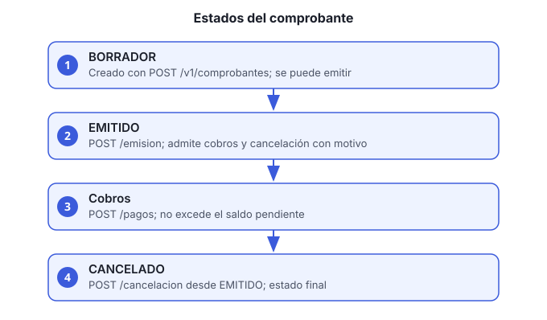

# Guía 8. Emitir un comprobante, registrar un cobro y cancelar

**Objetivo:** crear un comprobante para una orden de venta, emitirlo, registrar el cobro del cliente y, si hace falta, cancelarlo.

**Servicio:** `facturacion-pagos-ms`, bajo `/facturacion-pagos-ms/v1/comprobantes`.

**Roles:** `FINANZAS` para crear, emitir, cobrar y cancelar. `FINANZAS` o `VENTAS` para consultar.



## Estados

- **BORRADOR:** recién creado. Se puede emitir.
- **EMITIDO:** válido para cobro. Se puede cancelar con motivo.
- **CANCELADO:** final. No admite cobros.

## Antes de empezar

- El id de la orden de venta.
- Moneda permitida (las monedas válidas están definidas en el dominio del servicio).
- Subtotal mayor a cero.

## Pasos

1. **Crea el comprobante en borrador:**

   ```bash
   curl -s -X POST http://HOST/facturacion-pagos-ms/v1/comprobantes \
     -H "Authorization: Bearer ACCESS_TOKEN" -H "Content-Type: application/json" \
     -d '{"ordenId":"ORDEN_VENTA_ID","moneda":"MXN","subtotal":1200.00}'
   ```

   Anota el `id` y el `folio` de la respuesta.

2. **Emite el comprobante.** Solo los borradores se emiten:

   ```bash
   curl -s -X POST http://HOST/facturacion-pagos-ms/v1/comprobantes/COMPROBANTE_ID/emision \
     -H "Authorization: Bearer ACCESS_TOKEN"
   ```

   Emitir cambia el estado a EMITIDO. Intentar emitir uno que ya no es borrador responde error de regla de negocio.

3. **Consulta comprobantes pendientes de cobro** (rol `FINANZAS` o `VENTAS`). Devuelve los emitidos con saldo, con un máximo de 15 resultados, los más recientes primero:

   ```bash
   curl -s "http://HOST/facturacion-pagos-ms/v1/comprobantes/pendientes-cobro" \
     -H "Authorization: Bearer ACCESS_TOKEN"
   ```

   También puedes buscar por folio: `GET /v1/comprobantes?folio=FOLIO`.

4. **Registra el cobro** (rol `FINANZAS`). Solo en comprobantes emitidos:

   ```bash
   curl -s -X POST http://HOST/facturacion-pagos-ms/v1/comprobantes/COMPROBANTE_ID/pagos \
     -H "Authorization: Bearer ACCESS_TOKEN" -H "Content-Type: application/json" \
     -d '{"monto":1200.00,"fechaPago":"2026-11-05","referencia":"TRANSF-998877"}'
   ```

   - No se puede cobrar más que el saldo pendiente.
   - Un cobro completo deja el comprobante sin pendientes; ya no aparece en `pendientes-cobro`.

5. **Cancela el comprobante si es necesario** (rol `FINANZAS`). Solo emitidos, y el motivo es obligatorio:

   ```bash
   curl -s -X POST http://HOST/facturacion-pagos-ms/v1/comprobantes/COMPROBANTE_ID/cancelacion \
     -H "Authorization: Bearer ACCESS_TOKEN" -H "Content-Type: application/json" \
     -d '{"motivo":"Error en el subtotal"}'
   ```

   Un comprobante cancelado no admite cobros. Para corregirlo, crea un comprobante nuevo.

## Verificación

- `GET /v1/comprobantes/COMPROBANTE_ID` muestra el estado correcto.
- Después de un cobro completo, el comprobante ya no aparece en `pendientes-cobro`.

## Problemas comunes

| Síntoma | Causa | Qué hacer |
|---|---|---|
| Error al emitir | El comprobante no está en borrador | Consulta su estado; si ya está emitido, no hace falta emitirlo |
| Error al cobrar | Está en borrador o cancelado | Emítelo primero; un cancelado requiere comprobante nuevo |
| `El pago excede el saldo pendiente` | El monto es mayor al saldo | Corrige el monto |
| No aparece en pendientes de cobro | Ya está pagado o no está emitido | Consulta el comprobante por id |
