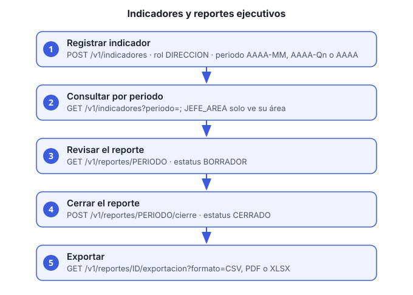

# Guía 9. Consultar indicadores para reportes ejecutivos

**Objetivo:** registrar los indicadores de cada área, consultarlos y generar el reporte mensual, que se puede exportar.

**Servicio:** `reportes-ejecutivos-ms`, bajo `/reportes-ejecutivos-ms/v1`.



## Roles

| Acción | Rol |
|---|---|
| Registrar indicador | `DIRECCION` |
| Consultar indicadores | `DIRECCION` (todas las áreas) o `JEFE_AREA` (solo la suya) |
| Ver un reporte | `DIRECCION` o `JEFE_AREA` |
| Cerrar un reporte | `DIRECCION` |
| Exportar | `DIRECCION` |

## Antes de empezar

- Usuario con el rol correspondiente. Para `JEFE_AREA`, el usuario debe tener área asignada (guía 5).
- El área debe coincidir con el enum de reportes: `VENTAS_ATENCION_CLIENTES`, `FINANZAS_CONTABILIDAD`, `OPERACIONES`, `COMPRAS_PROVEEDORES`, `ADMINISTRACION_LEGAL` o `DIRECCION_GENERAL`.

## Pasos

1. **Registra un indicador.** Cada indicador tiene área, nombre, periodo, valor y la fecha de actualización de la fuente. El periodo acepta `AAAA-MM` (mensual, como `2026-10`), `AAAA-Qn` (trimestral, como `2026-Q4`) o `AAAA` (anual):

   ```bash
   curl -s -X POST http://HOST/reportes-ejecutivos-ms/v1/indicadores \
     -H "Authorization: Bearer ACCESS_TOKEN" -H "Content-Type: application/json" \
     -d '{"area":"FINANZAS_CONTABILIDAD","nombre":"Cuentas por cobrar vencidas","periodo":"2026-10","valor":125000.50,"fuenteActualizadaUtc":"2026-11-02T18:00:00Z"}'
   ```

2. **Consulta los indicadores de un periodo.** El periodo es obligatorio; el área es opcional:

   ```bash
   curl -s "http://HOST/reportes-ejecutivos-ms/v1/indicadores?periodo=2026-10&area=FINANZAS_CONTABILIDAD" \
     -H "Authorization: Bearer ACCESS_TOKEN"
   ```

   Un `JEFE_AREA` solo ve su área aunque pida otra: el servicio usa el claim `area` de su token.

3. **Revisa el reporte del periodo:**

   ```bash
   curl -s http://HOST/reportes-ejecutivos-ms/v1/reportes/2026-10 \
     -H "Authorization: Bearer ACCESS_TOKEN"
   ```

   La respuesta muestra el estatus del reporte y los indicadores consolidados por área.

4. **Cierra el reporte** cuando todas las áreas hayan registrado sus indicadores (rol `DIRECCION`):

   ```bash
   curl -s -X POST http://HOST/reportes-ejecutivos-ms/v1/reportes/2026-10/cierre \
     -H "Authorization: Bearer ACCESS_TOKEN"
   ```

   Un reporte cerrado no cambia. Si falta un dato, corrígelo antes del cierre.

5. **Exporta el reporte** (rol `DIRECCION`). Usa el id del reporte que devuelve el paso 3. El formato va en `formato`: `CSV` (por defecto), `PDF` o `XLSX`:

   ```bash
   curl -s "http://HOST/reportes-ejecutivos-ms/v1/reportes/REPORTE_ID/exportacion?formato=XLSX" \
     -H "Authorization: Bearer ACCESS_TOKEN" -OJ
   ```

   `-OJ` guarda el archivo con el nombre que envía el servicio.

## Verificación

- `GET /v1/indicadores?periodo=PERIODO` lista el indicador recién registrado.
- `GET /v1/reportes/PERIODO` muestra el estatus y los consolidados.

## Problemas comunes

| Síntoma | Causa | Qué hacer |
|---|---|---|
| 403 al consultar | `JEFE_AREA` sin área, o área distinta a la del enum | Asigna el área correcta (guía 5) |
| 403 en un usuario con área válida | El token es anterior a la asignación | Inicia sesión de nuevo |
| El indicador no aparece en el consolidado | El periodo o el área no coinciden | Revisa `periodo` y `area` |
| Reporte no se puede cerrar o cambiar | Ya está cerrado | Un reporte cerrado es inmutable; registra el ajuste en el periodo siguiente |
