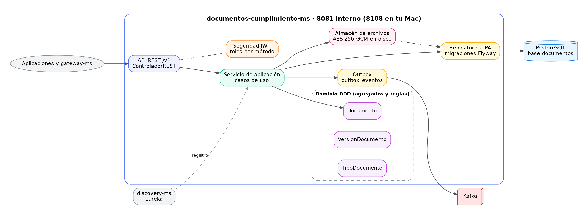
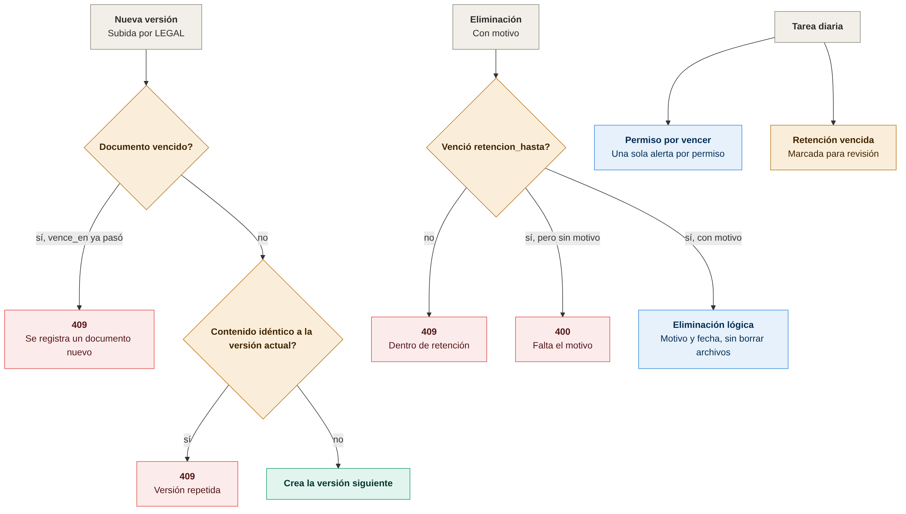
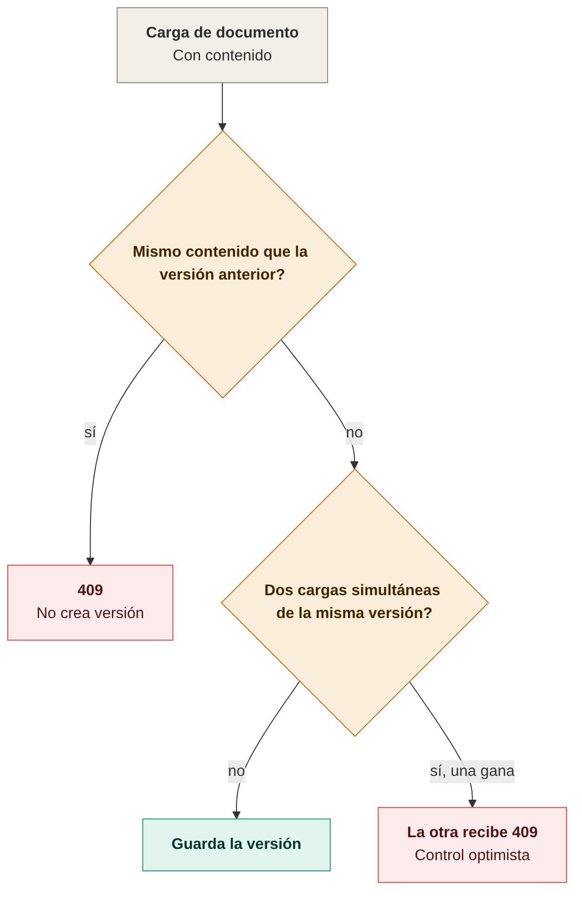
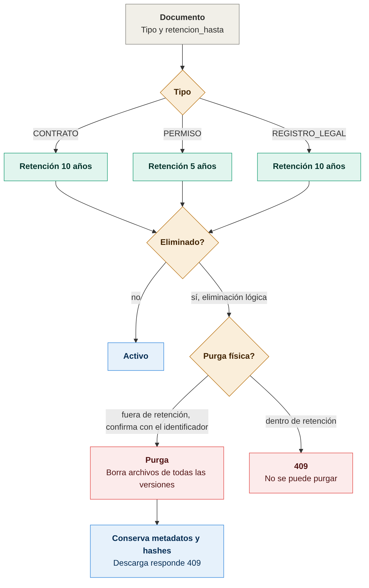

# Diagramas de documentos-cumplimiento-ms

Todos los diagramas son imágenes PNG. Cada imagen tiene su fuente en Mermaid (`.mmd`) en `docs/diagramas/`; para regenerarla:

```bash
cd docs/diagramas
mmdc -i nombre.mmd -o nombre.png -b white -w 1400 -s 2
```

## Arquitectura



## Estados, duplicados y retención

### Reglas de estado del documento


Cada cambio de contenido crea una versión; un documento vencido no recibe versiones y la eliminación solo es posible después de la retención, con motivo. Fuente: [01-reglas-de-estado.mmd](diagramas/01-reglas-de-estado.mmd).

### Reglas de duplicados


El mismo contenido consecutivo no crea versión, y dos cargas simultáneas se resuelven con control optimista. Fuente: [02-reglas-de-duplicados.mmd](diagramas/02-reglas-de-duplicados.mmd).

### Retención y purga física


La retención es de 10 años para CONTRATO y REGISTRO_LEGAL, y de 5 para PERMISO. La purga borra los archivos de todas las versiones, exige como confirmación el identificador del documento y conserva metadatos y hashes. Solo LEGAL puede purgar. Fuente: [03-retencion-y-purga-fisica.mmd](diagramas/03-retencion-y-purga-fisica.mmd).
