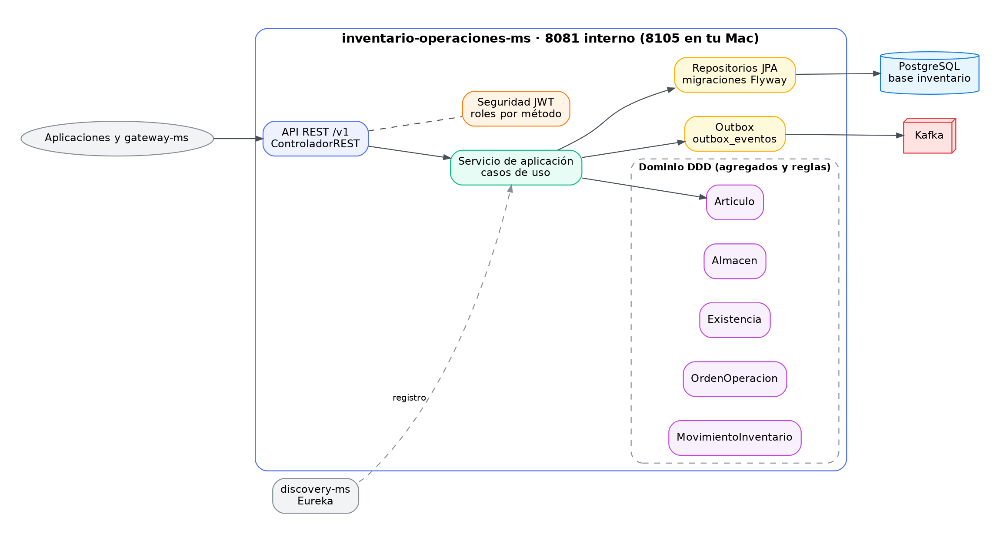
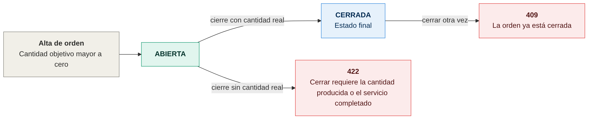
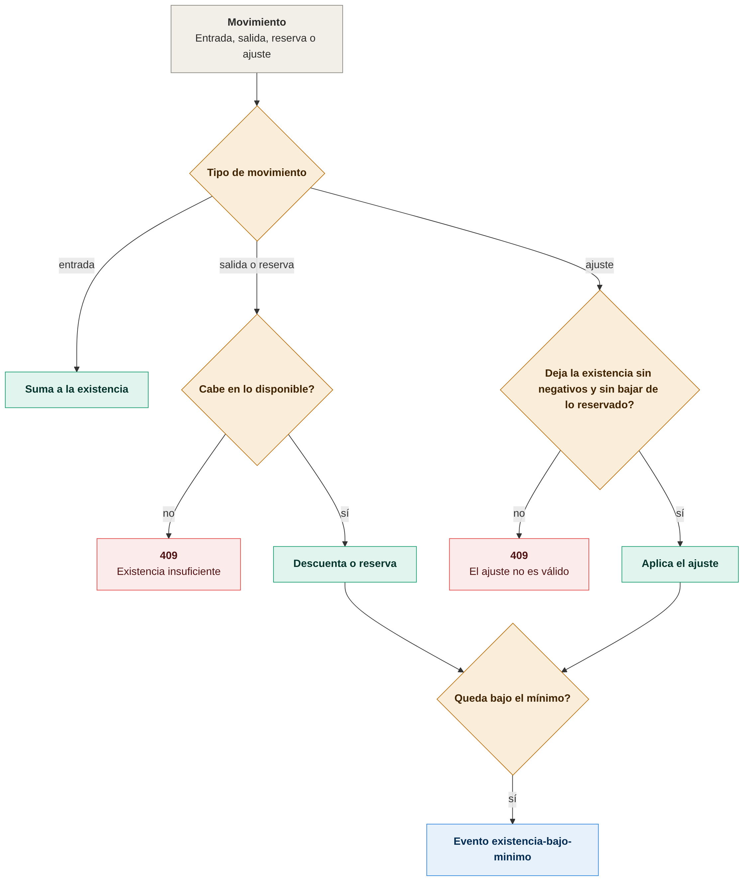
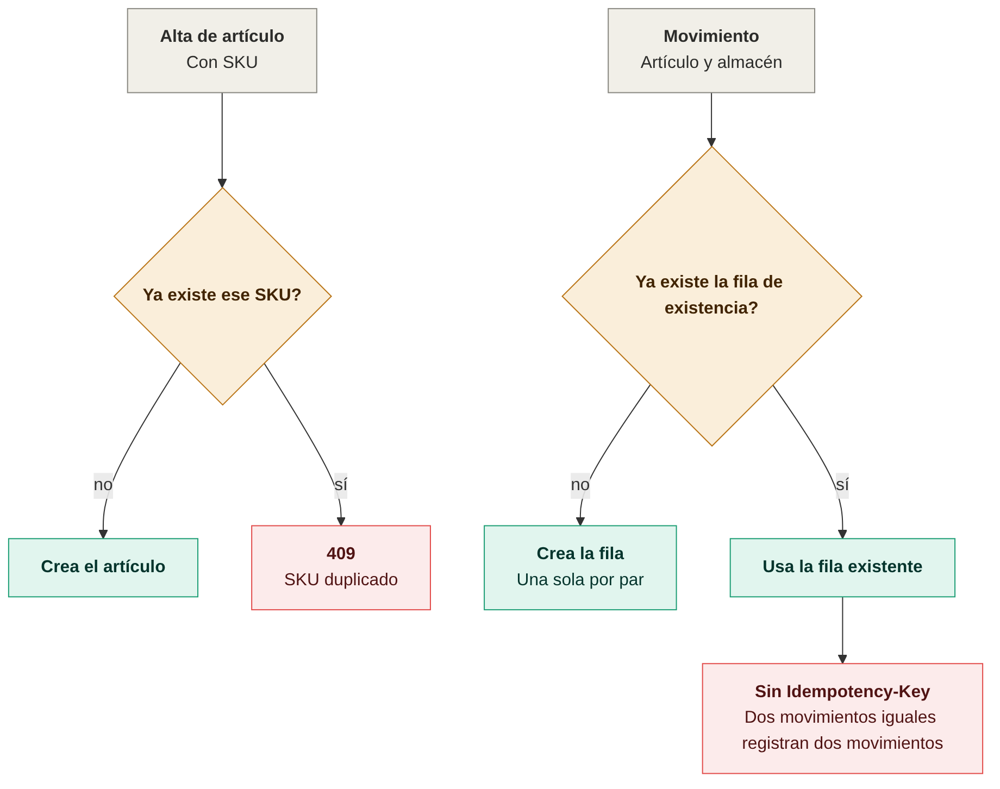
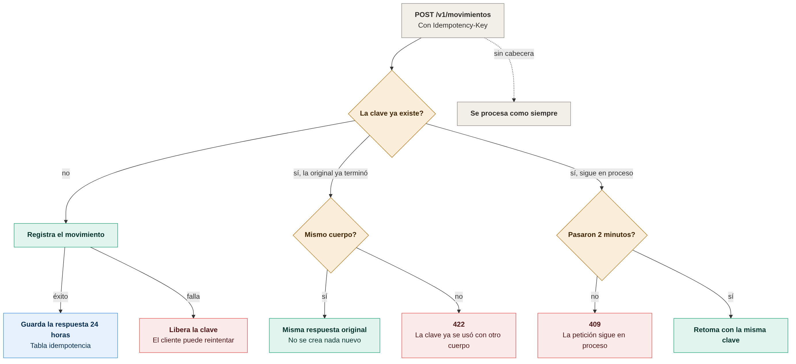

# Diagramas de inventario-operaciones-ms

Todos los diagramas son imágenes PNG. Cada imagen tiene su fuente en Mermaid (`.mmd`) en `docs/diagramas/`; para regenerarla:

```bash
cd docs/diagramas
mmdc -i nombre.mmd -o nombre.png -b white -w 1400 -s 2
```

## Arquitectura



## Estados, duplicados e idempotencia

### Máquina de estados de la orden de operación


Una orden se abre con cantidad objetivo mayor a cero y se cierra una sola vez, con cantidad real. Fuente: [01-maquina-de-estados-orden.mmd](diagramas/01-maquina-de-estados-orden.mmd).

### Reglas de la existencia


Cada entrada, salida, reserva o ajuste debe respetar que la existencia no sea negativa y que lo reservado no supere lo existente. Si queda bajo el mínimo se publica `existencia-bajo-minimo`. Fuente: [02-maquina-de-estados-existencia.mmd](diagramas/02-maquina-de-estados-existencia.mmd).

### Reglas de duplicados


El SKU es único (409 si se repite) y cada par artículo-almacén tiene una sola fila de existencia. Sin `Idempotency-Key`, dos movimientos iguales registran dos movimientos. Fuente: [03-reglas-de-duplicados.mmd](diagramas/03-reglas-de-duplicados.mmd).

### Idempotency-Key en movimientos


Con la misma clave y el mismo cuerpo se devuelve la respuesta original. Con otro cuerpo responde 422, y si la petición original sigue en proceso responde 409 hasta que pasen 2 minutos. Fuente: [04-idempotency-key-en-movimientos.mmd](diagramas/04-idempotency-key-en-movimientos.mmd).
