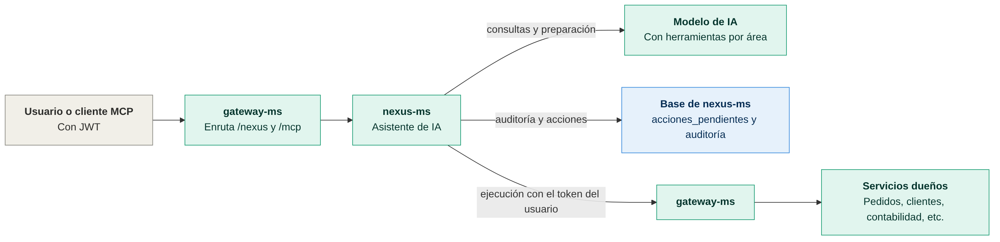
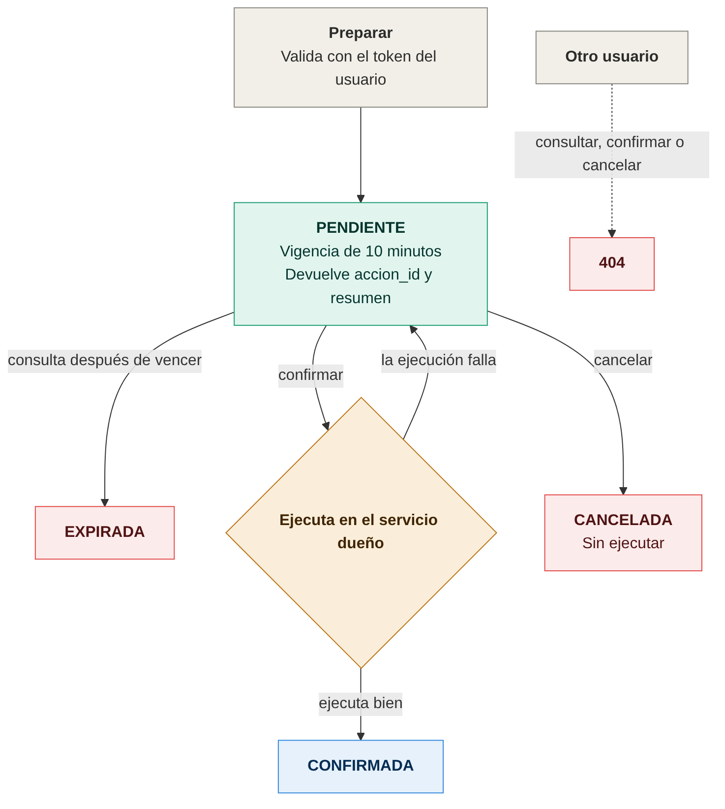
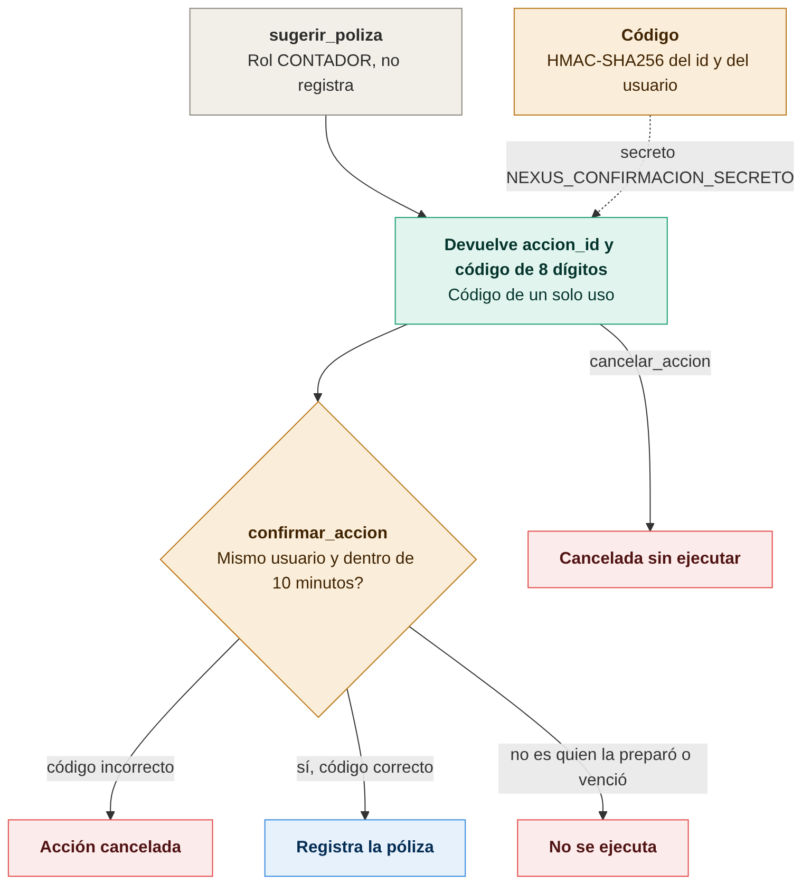

# Diagramas de nexus-ms

Todos los diagramas son imágenes PNG. Cada imagen tiene su fuente en Mermaid (`.mmd`) en `docs/diagramas/`; para regenerarla:

```bash
cd docs/diagramas
mmdc -i nombre.mmd -o nombre.png -b white -w 1400 -s 2
```

## Arquitectura



El asistente recibe las peticiones por el gateway, consulta al modelo con herramientas por área y ejecuta las acciones en los servicios dueños con el token del usuario. Fuente: [01-arquitectura.mmd](diagramas/01-arquitectura.mmd).

## Acciones con confirmación



Una acción se prepara con vigencia de 10 minutos y solo se ejecuta si el usuario la confirma; si la ejecución falla, sigue pendiente. Fuente: [02-acciones-con-confirmacion.mmd](diagramas/02-acciones-con-confirmacion.mmd).

## Acciones por MCP



Por MCP, la confirmación exige un código de 8 dígitos de un solo uso además del JWT. Un código incorrecto cancela la acción. Fuente: [03-acciones-por-mcp.mmd](diagramas/03-acciones-por-mcp.mmd).
