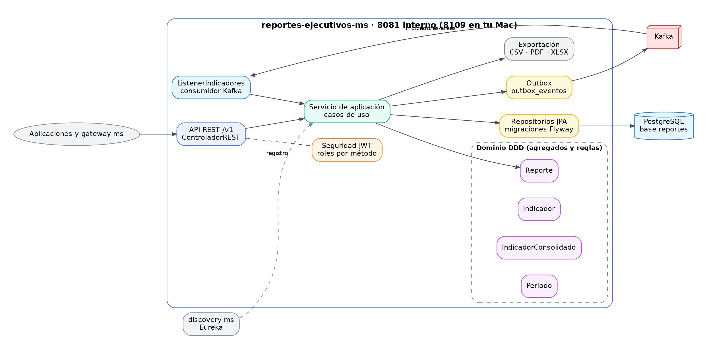
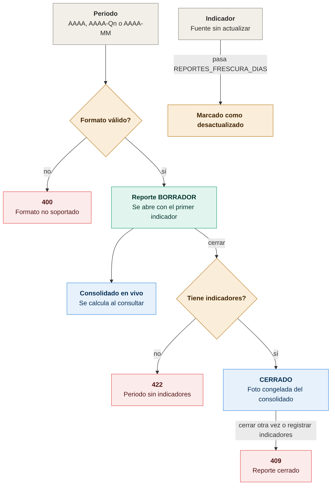
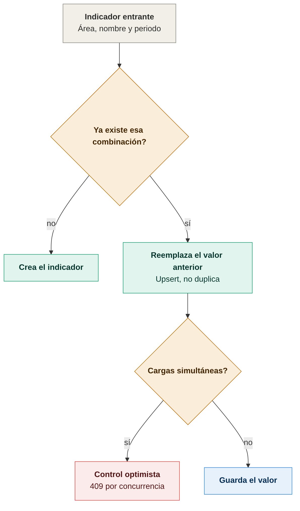
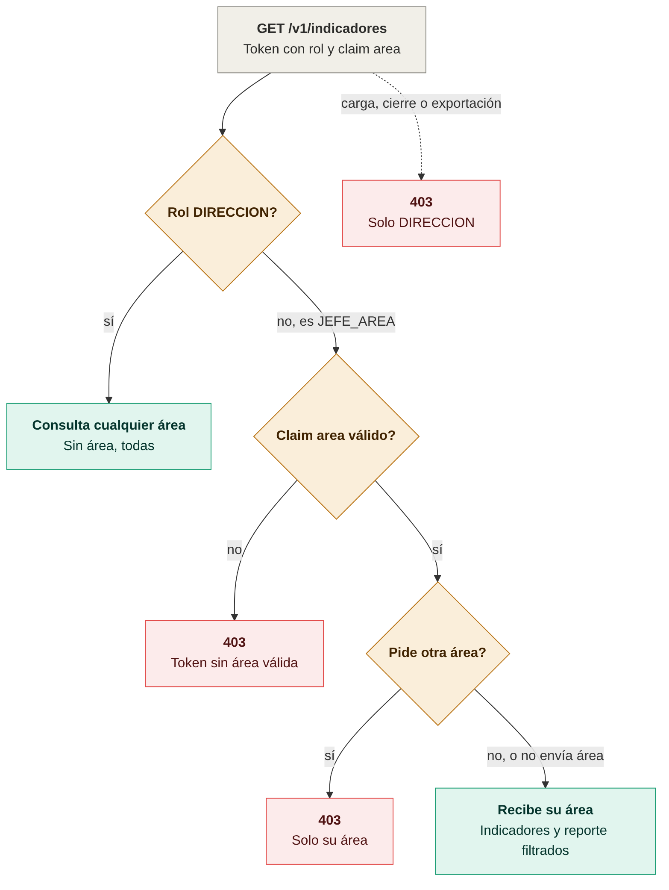

# Diagramas de reportes-ejecutivos-ms

Todos los diagramas son imágenes PNG. Cada imagen tiene su fuente en Mermaid (`.mmd`) en `docs/diagramas/`; para regenerarla:

```bash
cd docs/diagramas
mmdc -i nombre.mmd -o nombre.png -b white -w 1400 -s 2
```

## Arquitectura



## Estados, duplicados y lectura por área

### Reglas de estado de periodos y reportes


Un periodo debe usar `AAAA`, `AAAA-Qn` o `AAAA-MM`. Un reporte cerrado es una foto congelada: cerrarlo de nuevo o registrar indicadores de ese periodo responde 409. Fuente: [01-reglas-de-estado.mmd](diagramas/01-reglas-de-estado.mmd).

### Reglas de duplicados


Un indicador con la misma área, nombre y periodo reemplaza al anterior; no se duplica. Las cargas simultáneas se resuelven con control optimista. Fuente: [02-reglas-de-duplicados.mmd](diagramas/02-reglas-de-duplicados.mmd).

### Lectura por área (JEFE_AREA)


DIRECCION consulta cualquier área. JEFE_AREA solo ve su área, según el claim `area` del token, y recibe 403 si pide otra. Carga, cierre y exportación siguen solo para DIRECCION. Fuente: [03-lectura-por-area.mmd](diagramas/03-lectura-por-area.mmd).
