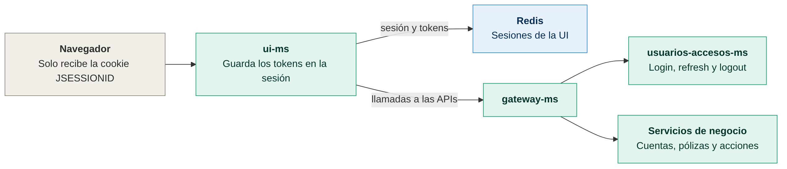
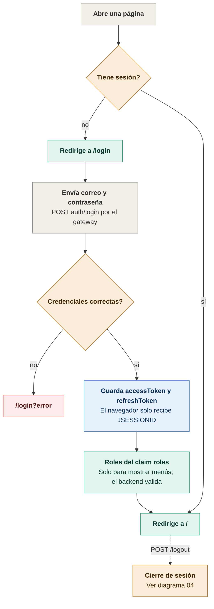
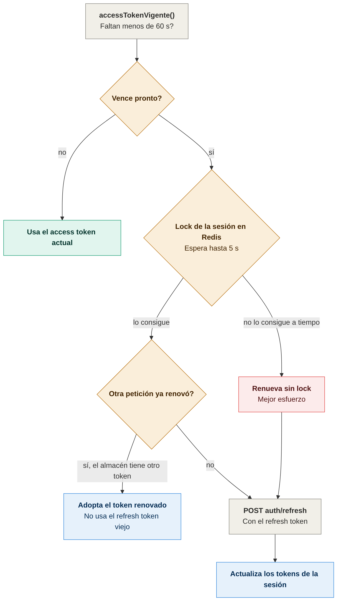
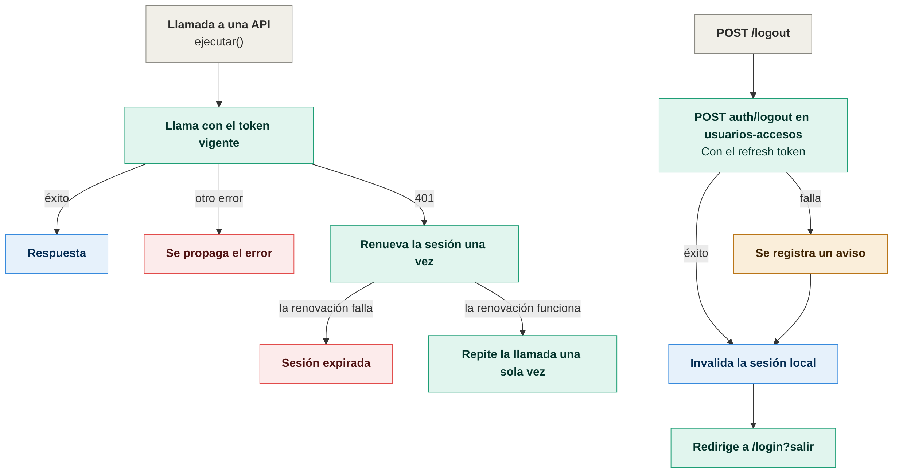

# Diagramas de ui-ms

Todos los diagramas son imágenes PNG. Cada imagen tiene su fuente en Mermaid (`.mmd`) en `docs/diagramas/`; para regenerarla:

```bash
cd docs/diagramas
mmdc -i nombre.mmd -o nombre.png -b white -w 1400 -s 2
```

## Arquitectura

### Arquitectura de la interfaz


El navegador solo recibe la cookie `JSESSIONID`. Los tokens viven en Redis y las llamadas a las APIs pasan por el gateway. Fuente: [01-arquitectura.mmd](diagramas/01-arquitectura.mmd).

## Login y sesión

### Inicio de sesión


Si las credenciales son correctas, los tokens se guardan en la sesión del servidor. Fuente: [02-login-y-sesion.mmd](diagramas/02-login-y-sesion.mmd).

### Renovación con lock


Si el token vence en menos de 60 segundos, la renovación se serializa con un lock en Redis. Si otra petición ya renovó, se adopta ese token. Fuente: [03-renovacion-con-lock.mmd](diagramas/03-renovacion-con-lock.mmd).

### Reintento tras 401 y cierre de sesión


Un 401 renueva la sesión y repite la llamada una sola vez. El cierre de sesión revoca en usuarios-accesos y cierra la sesión local aunque esa llamada falle. Fuente: [04-reintento-y-cierre.mmd](diagramas/04-reintento-y-cierre.mmd).
