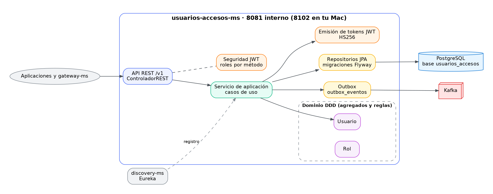
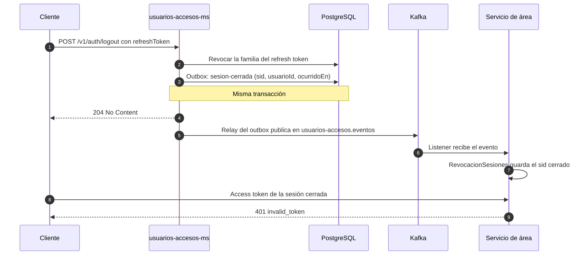
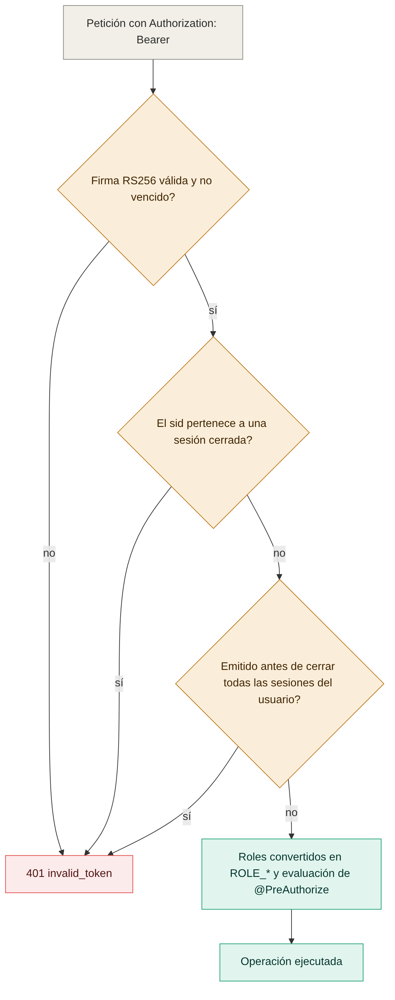
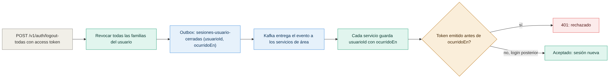
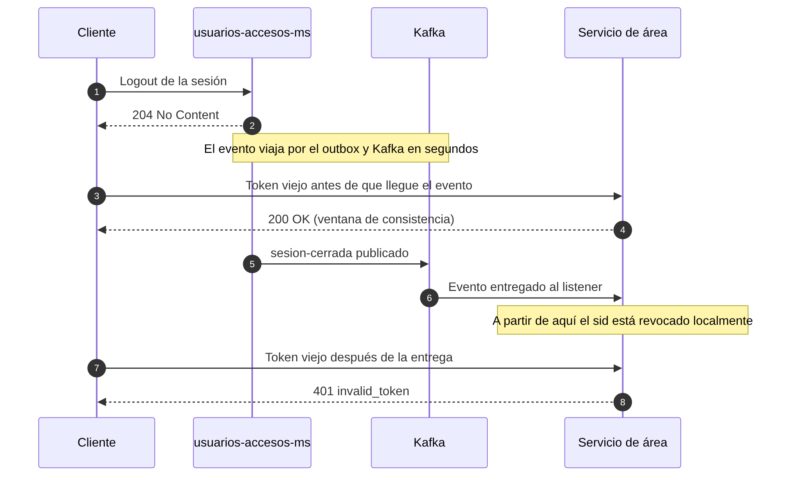

# Diagramas de usuarios-accesos-ms

Todos los diagramas son imágenes PNG. Cada imagen tiene su fuente en Mermaid (`.mmd`) en `docs/diagramas/`; para regenerarla:

```bash
cd docs/diagramas
mmdc -i nombre.mmd -o nombre.png -b white -w 1400 -s 2
```

## Arquitectura



## Revocación de access tokens

### Cierre de sesión


Un logout escribe el evento en el outbox dentro de la misma transacción y responde 204. Cada servicio de área lo recibe por Kafka y rechaza el `sid` cerrado. Fuente: [01-cierre-de-sesion.mmd](diagramas/01-cierre-de-sesion.mmd).

### Validación en cada servicio


El orden es: firma y vencimiento, `sid` revocado y, por último, fecha de emisión frente a `logout-todas`. Solo entonces se evalúan los roles. Fuente: [02-validacion-token.mmd](diagramas/02-validacion-token.mmd).

### Cerrar todas las sesiones


Los tokens emitidos antes del cierre se rechazan; un login posterior funciona. Fuente: [03-cerrar-todas.mmd](diagramas/03-cerrar-todas.mmd).

### Ventana de consistencia


Entre el logout y la entrega del evento, el token todavía se acepta. Fuente: [04-ventana-consistencia.mmd](diagramas/04-ventana-consistencia.mmd).
