# Diagramas de usuarios-accesos-ms

Todos los diagramas son imágenes PNG. Cada imagen tiene su fuente en Mermaid (`.mmd`) en `docs/diagramas/`; para regenerarla:

```bash
cd docs/diagramas
mmdc -i nombre.mmd -o nombre.png -b white -w 1400 -s 2
```

## Arquitectura

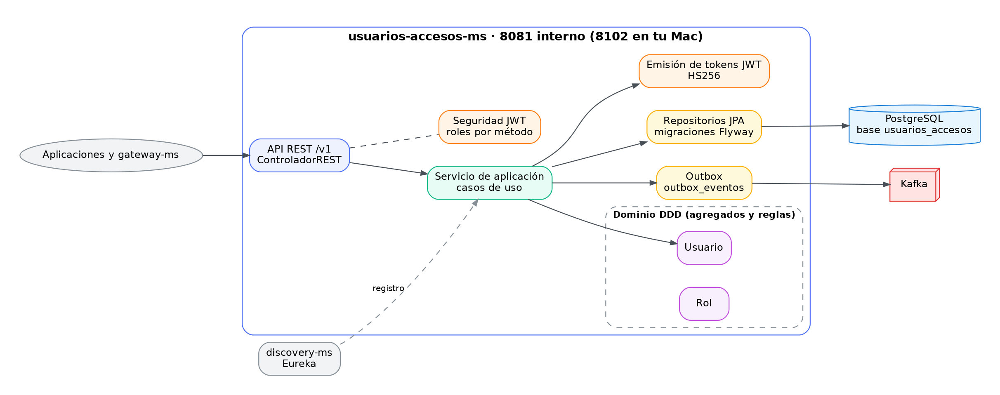

## Revocación de access tokens

### Cierre de sesión
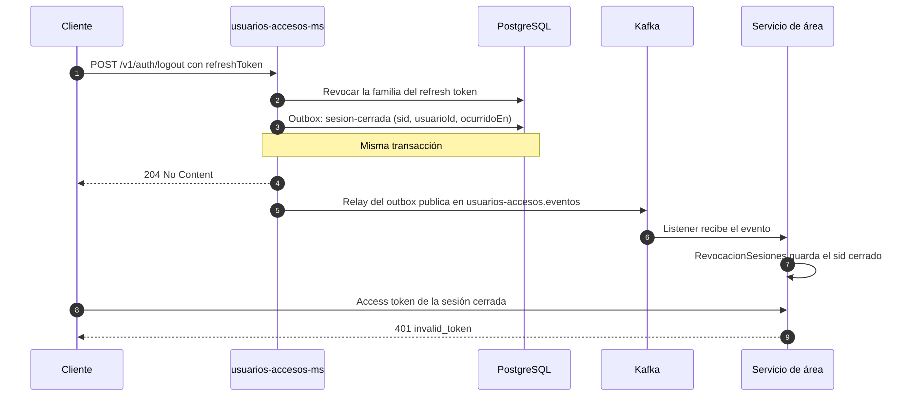

Un logout escribe el evento en el outbox dentro de la misma transacción y responde 204. Cada servicio de área lo recibe por Kafka y rechaza el `sid` cerrado. Fuente: [01-cierre-de-sesion.mmd](diagramas/01-cierre-de-sesion.mmd).

### Validación en cada servicio
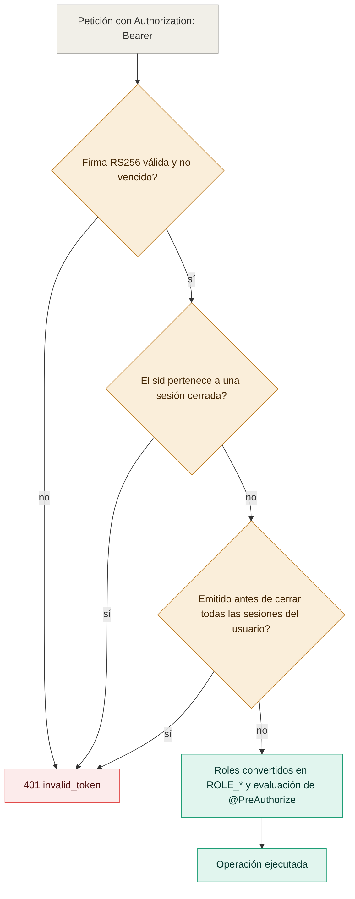

El orden es: firma y vencimiento, `sid` revocado y, por último, fecha de emisión frente a `logout-todas`. Solo entonces se evalúan los roles. Fuente: [02-validacion-token.mmd](diagramas/02-validacion-token.mmd).

### Cerrar todas las sesiones
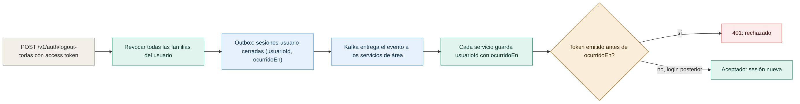

Los tokens emitidos antes del cierre se rechazan; un login posterior funciona. Fuente: [03-cerrar-todas.mmd](diagramas/03-cerrar-todas.mmd).

### Ventana de consistencia
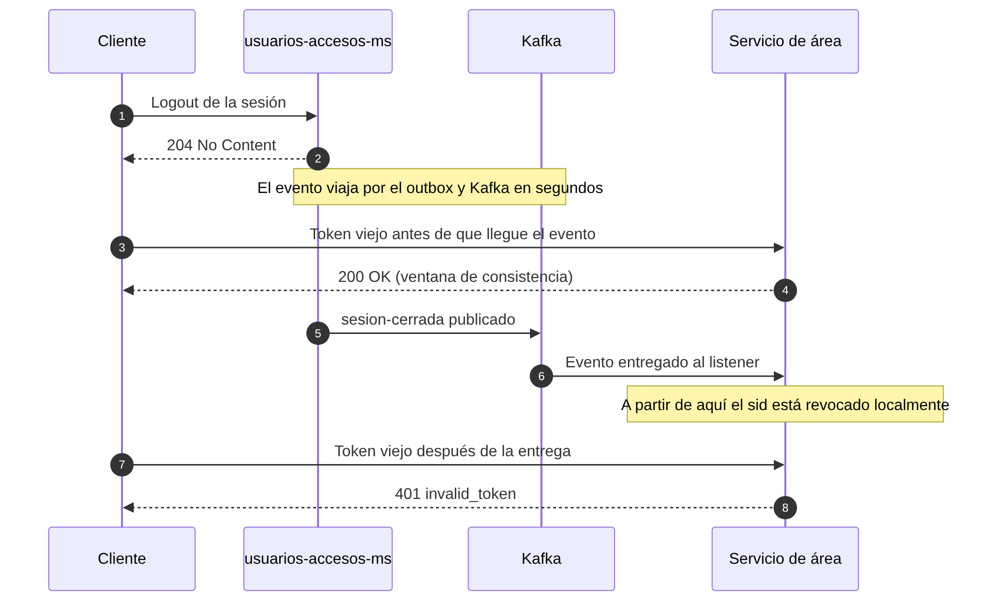

Entre el logout y la entrega del evento, el token todavía se acepta. Fuente: [04-ventana-consistencia.mmd](diagramas/04-ventana-consistencia.mmd).

## Estados, duplicados y altas

### Estatus del usuario
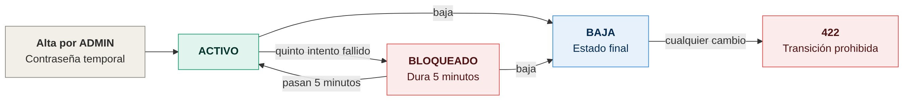

Un usuario pasa de `ACTIVO` a `BLOQUEADO` al quinto intento fallido y vuelve a `ACTIVO` a los 5 minutos. `BAJA` es final: cualquier cambio desde ahí responde 422. Fuente: [05-maquina-de-estados-usuario.mmd](diagramas/05-maquina-de-estados-usuario.mmd).

### Reglas de duplicados
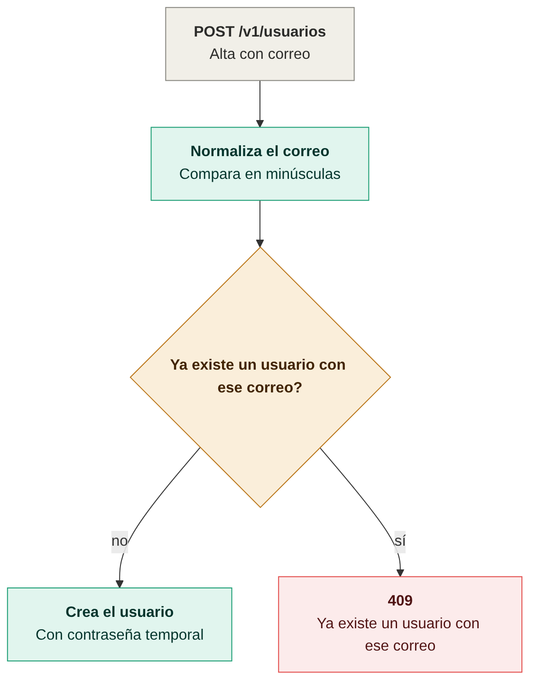

El correo se compara en minúsculas. Si ya existe, la alta responde 409. Fuente: [06-reglas-de-duplicados.mmd](diagramas/06-reglas-de-duplicados.mmd).

### Idempotency-Key en altas (pendiente)
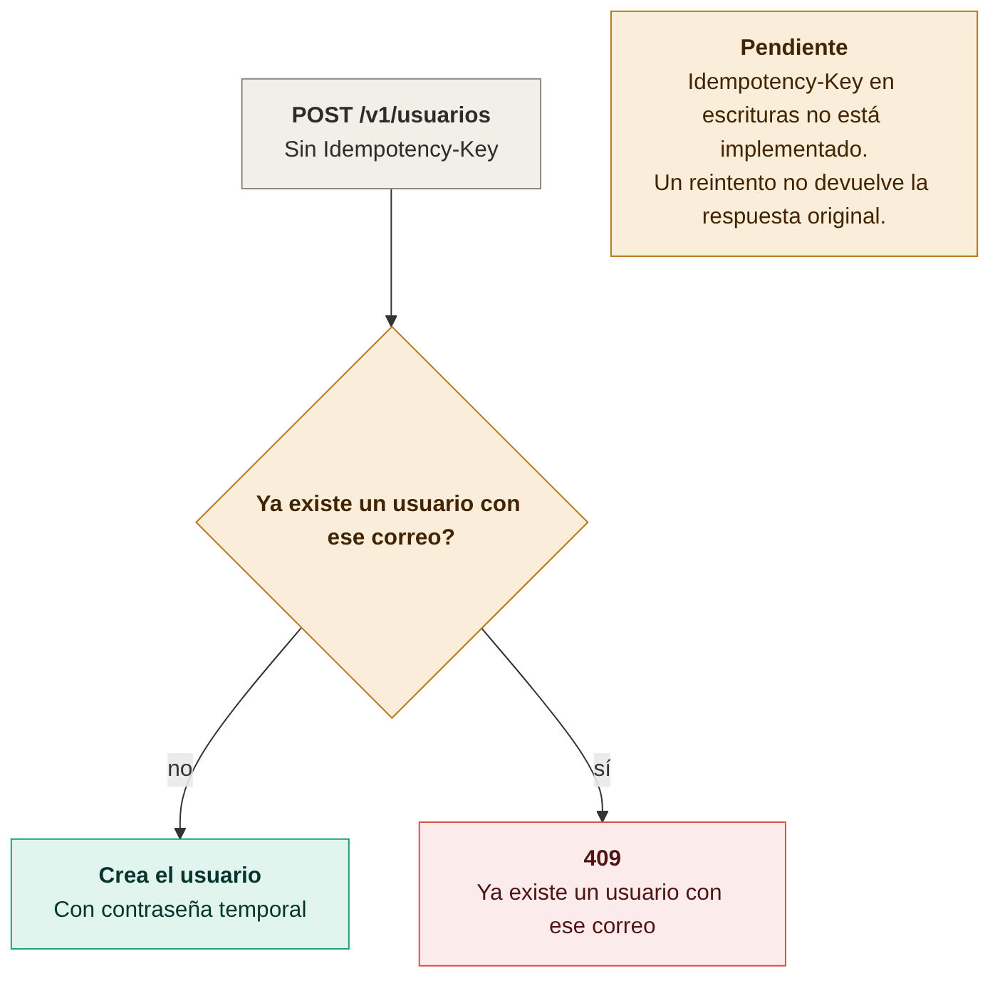

Hoy el alta no acepta `Idempotency-Key`. Un reintento se resuelve por la regla de correo único y responde 409, no con la respuesta original. Fuente: [07-idempotency-key-en-altas.mmd](diagramas/07-idempotency-key-en-altas.mmd).

## Seguridad y cuentas

### Rotación de la clave RS256
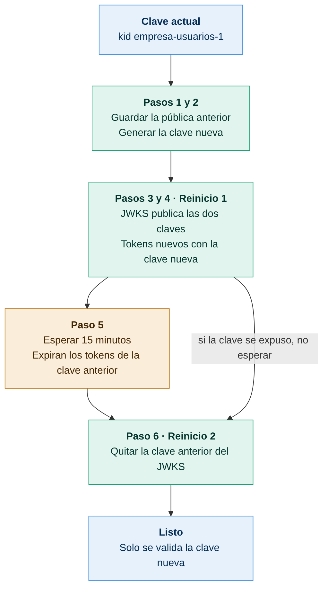

El JWKS publica dos claves durante la rotación, así que las sesiones no se cortan. Si la clave se expuso, se quita la anterior de inmediato. Fuente: [08-rotacion-clave-rs256.mmd](diagramas/08-rotacion-clave-rs256.mmd).

### Área y rol JEFE_AREA
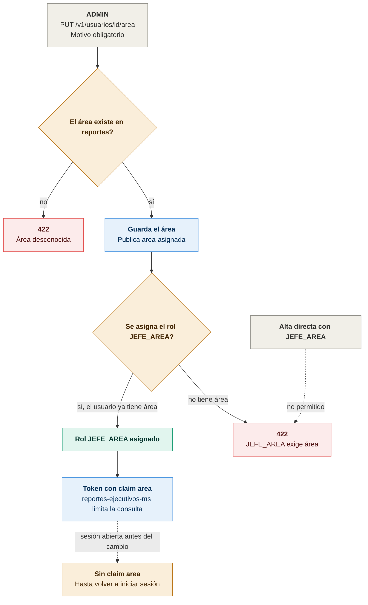

El rol `JEFE_AREA` exige área: sin ella responde 422, y no se puede asignar en el alta. Un área desconocida para reportes también responde 422. Fuente: [09-area-y-rol-jefe-area.mmd](diagramas/09-area-y-rol-jefe-area.mmd).

### Contraseña temporal
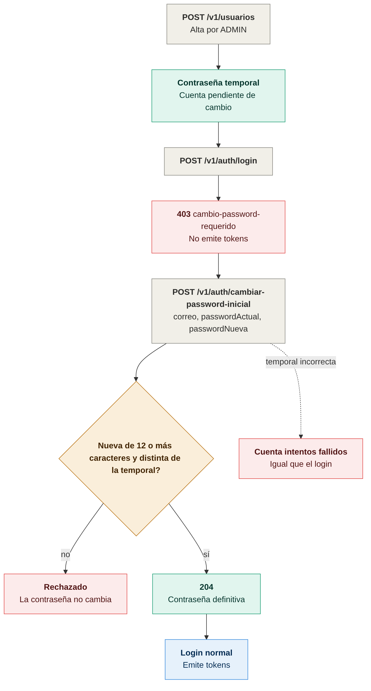

Mientras la contraseña es temporal, el login responde 403 y no emite tokens. El cambio exige al menos 12 caracteres y que sea distinta de la temporal. Fuente: [10-contrasena-temporal.mmd](diagramas/10-contrasena-temporal.mmd).
